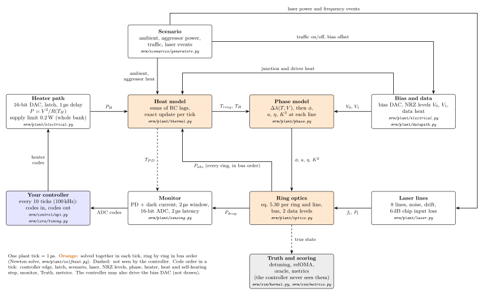

# mrm: a control-oriented model of a silicon microring-modulator bank

`mrm` simulates a bank of eight silicon microring modulators on one bus waveguide, the heaters and converters around
them, and the outside disturbances (aggressor heaters, package temperature, laser drift, traffic), tick by tick. Its
purpose is to design and score heater wavelength-lock controllers. A controller sees only what the real hardware
would show it: monitor ADC codes in, heater DAC codes out. The default device is the Lightmatter G26 transmit bank
(preset `g26`). Most of its numbers come from public papers, talks and patents or from solver estimates, and every
number in a preset records where it came from.



## Install

```sh
python3.12 -m venv .venv
.venv/bin/pip install -e '.[dev]'
```

The optional extras are `extract` (the offline mode, coupler, junction and thermal solvers), `rl` (gymnasium) and
`hdl` (cocotb).

## First run

Run every Python job from the repository root through the memory guard. The first run compiles the plant kernel,
which can take a few minutes.

```sh
.venv/bin/python tools/memguard.py -- .venv/bin/mrm run experiments/examples/steady_pi_lock.yaml
```

This runs the shipped PI lock (`pi_lock_c`) on all eight rings at constant ambient temperature for 40 ms and prints
the lock metrics. [docs/EXPLAINED.md](docs/EXPLAINED.md), "Try it", lists the next runs.

## What to read, in order

Documents:

1. [docs/guide/mrm_guide.pdf](docs/guide/mrm_guide.pdf): the reading guide, written for a reader who knows textbook
   chapters 0 to 5 (waveguides, coupling, the ring resonator). It goes from your add-drop ring to the whole model.
2. [docs/EXPLAINED.md](docs/EXPLAINED.md): the physical picture, and the first runs.
3. [docs/KNOWN_ISSUES.md](docs/KNOWN_ISSUES.md): what the model does not do yet.
4. [docs/ENGINE.md](docs/ENGINE.md), sections 1-6: how to run the engine and what happens in one tick.
5. [docs/ARCHITECTURE.md](docs/ARCHITECTURE.md), section 2: where each part of the code lives.
6. [docs/CODE_STYLE.md](docs/CODE_STYLE.md): how the code is written.

Code (the same order as the package docstrings and docs/ARCHITECTURE.md):

1. `examples/controllers/template_python_controller.py` and `mrm/control/api.py`: what a controller gets and returns.
2. `mrm/plant/optics.py`, `_airy_line`: the add-drop ring in closed form.
3. `mrm/plant/phase.py`, `ring_optics_row`: where the ring's phase, coupling and loss come from.
4. `mrm/plant/selfheat.py`, `solve_ring_temperature`, and `mrm/plant/thermal.py`: self-heating and the heat paths.
5. `mrm/plant/sensing.py`, `monitor_tick_row`: from drop power to a monitor ADC code.
6. `mrm/sim/kernel_ref.py`, `ReferenceEngine.step`: one tick in plain NumPy. `mrm/sim/kernel.py` is the fast copy of
   the same tick; skip it until you need it.
7. `mrm/sim/runner.py`, `run`: one closed-loop run of B worlds.

## Words

| word | meaning |
|---|---|
| world | one sampled set of device parameters (batch index b); B worlds run side by side |
| g26 | the default preset (`mrm/params/presets/g26.yaml`). G25 and G26 (capital G) are Lightmatter device generations |
| preset | a YAML file of device parameters; every number carries its value, provenance and source |
| tick | the plant time step, 1 µs by default; time is an integer count of ticks |
| substep | one thermal step of h ticks (h = 1, or a power of two under the automatic substep policy) |
| edge | a tick at which the controller runs (a controller edge) |
| Truth | the true plant state (detuning, temperatures, powers); never shown to the controller |
| detuning | resonance wavelength minus laser-line wavelength (positive: the resonance is red of the line) |
| relOMA | \|P_thru,1 − P_thru,0\| / P_in: the modulation amplitude relative to the ring's input power |
| oracle | the best relOMA over the detuning at that instant, among the open-loop-stable points |
| scenario | the disturbances of a run as signals over time (aggressor heaters, soak, laser drift, traffic) |
| experiment | a YAML file that names a preset, a controller, a scenario, the start state and the scoring |

## Checks

```sh
.venv/bin/python tools/memguard.py --limit-gb 5 -- .venv/bin/python -m pytest -q -m "not slow" -p no:cacheprovider
.venv/bin/python tools/memguard.py --heavy -- .venv/bin/mrm golden
```

The first is the fast test suite. The second checks that the plant still gives the committed golden traces.
[docs/RENAMES.md](docs/RENAMES.md) lists the names that changed in the readability pass.
