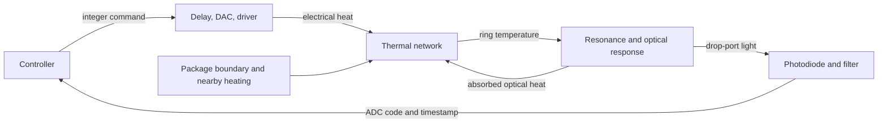

# What the simulator means physically

The controller tries to keep a resonance at a useful position relative to a
laser. Heating silicon usually moves the resonance to a longer wavelength,
or lower optical frequency. It does not move the laser. A detector turns the
resulting change in optical power into a number the controller can read.

There are two feedback loops. The intended loop runs through the controller
and heater. The other exists in the device itself: absorbed light produces
heat, heat shifts the resonance, and that shift changes the absorbed light.
That second loop is why a model that adds a constant optical-heating offset
can miss hysteresis and thermal instability.

## The optical ring

Light repeatedly circulates around the ring. At certain wavelengths the
round-trip phase is an integer number of full turns, so the circulating fields
reinforce. The bus waveguide then interferes with light that has traveled
through the ring. This determines how much leaves through the through port,
the drop port, or intrinsic loss.

The exact static calculation uses round-trip attenuation and coupling
amplitudes, rather than assigning a notch width and notch depth independently.
Consequently changing loss changes both linewidth and extinction. It also
changes optical storage and, if the loss is absorptive, heat. This keeps
related quantities physically tied together.

Intrinsic loss is not synonymous with heat deposited in the ring. Scattered
light can leave it. The absorption fraction is explicit because the public
paper does not identify that loss budget.

## An MRM carries data as well as receiving heat

Reverse bias changes the junction carriers, which change both refractive index
and loss. RingLab can take those voltage relationships from a measured table;
the supplied square-root depletion law is an illustrative compact model.
It does not infer the undisclosed doping or replace semiconductor TCAD.

At 50 Gb/s, a bit lasts 20 ps. The cavity can still contain light from previous
bits. Treating every bit as an independently settled optical level can then
give the wrong average detector reading and heat load. RingLab solves the
stationary first and second cavity-field moments for independent NRZ bits near
resonance. Short waveform runs additionally resolve the junction RC response.

Those two modes answer different questions. Statistical averaging is fast
enough to couple to slow thermal states. A waveform shows transitions and eye
closure. The statistical mode assumes ideal electrical edges and independent
bits; a PRBS pattern, finite driver bandwidth, or correlated lanes requires
the waveform checks. In a WDM bank, far-away carriers use the exact periodic
static response with an explicitly approximate transition to the local
dynamic model. The source documentation quantifies discrepancies without
calling them guaranteed error bounds.

## The thermal network

Think of a heat capacity as a bucket that stores energy, and a thermal
conductance as a path through which energy flows according to temperature
difference. A heater and a waveguide occupy different nodes. A shared package
and neighboring connections let one ring's heat reach another.

The default network is illustrative. Its conductances and capacities are not
Lightmatter measurements. The spatial extraction workflow starts instead
with specified layer thicknesses, conductivities, and source locations. Mesh
refinement checks whether the numerical prediction has converged. Reducing
that spatial model makes repeated control experiments practical, but the
reduction must reproduce both transient and steady responses.

Temperatures are absolute states. If the ambient boundary suddenly changes,
the ring temperature remains continuous and changes as heat flows. Simply
adding an ambient step to every ring would bypass the very dynamics a thermal
controller needs to be tested against.

## The controller sees the hardware interface

The simulation knows the ring temperature and detuning. The controller does
not. It receives an ADC code sampled earlier, with a timestamp and clipping
flag. Photodiode current passes through a filter; noise, quantization, latency,
and saturation can make a real change hard to distinguish from noise.

Similarly, a requested code does not immediately become heater power. It
passes through compute and actuator delays, a DAC, driver settling, and
compliance limits. Electrical heating follows voltage squared divided by the
temperature-dependent resistance.

The baseline scan-and-PI controller first measures a drop-port peak, chooses
a fractional-height point on its red side, and then regulates that reading.
The dither controller instead searches for the drop-port maximum. These are
different objectives: maximum drop power is not generally maximum transmitted
OMA. The comparison reports OMA and heater cost alongside the monitor result.
Neither baseline is presented as Lightmatter's undocumented algorithm or as
complete production firmware.

Scan and dither measurements wait until the requested code is observed at the
actuator and a later sample arrives, then count their configured settling/dwell
frames. This separates delayed old readings from the new setting; it does not
prove that an unknown thermal pole has settled. A scan containing a clipped
measurement fails acquisition because its true peak height is unknown.

## What confidence in a result requires

Three questions need different evidence:

1. Are the equations implemented correctly? Energy conservation, closed-form
   limits, timing tests, and independent discretization checks address this.
2. Is the numerical solution sufficiently resolved? Tightening ODE tolerances,
   refining spatial meshes, and comparing direct and reduced calculations
   address this for specified conditions.
3. Does it predict the actual device? That requires independent measurements
   on the intended device, including conditions withheld during fitting.

A successful synthetic control run answers neither the third question nor
whether a controller meets Lightmatter's BER. The supplied OFC paper reports
successful closed-loop operation but does not publish enough open-loop data
to identify the plant uniquely. The highest-value next evidence is synchronized
heater command, actual voltage/current, drop-monitor readings, and temperature
under known perturbations, with the existing controller disabled or documented.

The comparison study deliberately varies uncertain physical parameters and
reuses each case across controllers. Its input ranges are sensitivity
assumptions, not manufactured-device confidence intervals. Unknown correlations
must be represented by explicit joint cases or real measured distributions.

The textbook remains useful for intuition. The [comparison document](TEXTBOOK_COMPARISON.md)
identifies where a teaching assumption changes a model prediction, where public
sources describe different hardware generations, and where a derivation needs
more information. The simulator treats these differences as testable hypotheses.
