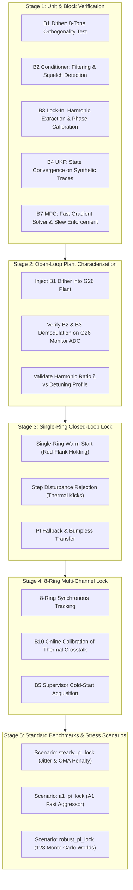

# TLC Porting Specification and Integration Plan
**Target Repository:** `mrm-model`  
**Source Repository:** `ECE496_project` (`thermal_control/tlc/`)  
**Branch:** `feature/tlc-port`  
**Status:** DRAFT / READY FOR IMPLEMENTATION  

---

## 1. Executive Summary

This document specifies the architecture, interfaces, and phased plan for porting the **Thermal Locking Controller (TLC)** from `ECE496_project` into `mrm-model`. 

* **The Goal**: Enable the 10-block TLC architecture (dither, signal conditioning, lock-in demodulation, UKF dual-channel estimator, supervisor FSM, setpoint calculation, fast-gradient MPC, slew/guard output, diagnostics, and online RLS calibration) to control the Lightmatter G26 8-channel microring modulator transmitter bank within the `mrm-model` multi-physics simulation engine.
* **Key Evolution**: Transitioning from a 4-ring toy plant with fixed parameters to an 8-ring production-grade simulator supporting batched simulation `(B, N)`, hardware ADC/DAC code interfaces, Monte Carlo uncertainty "worlds", and extreme thermal disturbances (the A1 on-die aggressor).

---

## 2. Specification: TLC on the MRM Controller Interface

### 2.1 Interface & Timing Contracts

In accordance with `mrm-model`'s controller API (`mrm.control.api` / `07 P1-19`):

1. **Execution Rate & Periods**:
   * Plant simulation step: $\Delta t = 1\ \mu\text{s}$.
   * Controller execution step: Default $T_s = 100\ \mu\text{s}$ ($10\text{ kHz}$, `period_ticks = 100`), matching ECE496 design. Alternatively supports $T_s = 10\ \mu\text{s}$ ($100\text{ kHz}$, `period_ticks = 10`).
   * Latency: Controller outputs take effect after `latency_ticks` (default 0 or 1 step) followed by the hardware DAC register latch.
2. **Inputs (`Observation`)**:
   * `obs["tx.monitor"]`: ADC codes for each ring `(B, N)` (12-bit or 16-bit unsigned integers).
   * `obs["tx.monitor.samples"]`: Raw high-rate ADC samples over the past step block (for B2 conditioning & squelch detection).
   * `obs["tx.heater.applied"]`: Last applied heater DAC code `(B, N)` (for bumpless hand-off and UKF prediction).
   * `spec.nominal`: Nominal knowledge view (channel frequencies, line grid, nominal thermal/optical parameters).
3. **Outputs (`dict[str, np.ndarray]`)**:
   * `{"tx.heater": codes}`: Integer DAC codes `(B, N)` formatted as `int64` in range `[spec.heater_dac.code_min, spec.heater_dac.code_max]` (nominally `[0, 65535]`).
4. **Telemetry**:
   * Telemetry dictionary per step: `delta_hat` (estimated detuning in pm), `rate_hat` (estimated drift in pm/ms), `modes` (supervisor FSM state), `locked` (boolean mask), `dither_amp`, `alarms`, and `oma_penalty`.

---

### 2.2 Architectural Mapping (Blocks B1 – B10)

| Block | ECE496 Implementation ($N=4$, Toy Plant) | `mrm-model` Implementation ($N=8$, G26 Engine) | Adapting Logic & Math |
| :--- | :--- | :--- | :--- |
| **B1 Dither** | 4 sinusoidal tones (2.0, 3.0, 3.5, 4.5 kHz) on 250 Hz grid. | 8 orthogonal sinusoidal tones (1.5, 2.0, 2.5, 3.0, 3.5, 4.0, 4.5, 5.0 kHz) or staggered orthogonal Walsh/square patterns. | Tone frequencies placed on a shared grid over the 4 ms Hann window; amplitude scheduled in DAC codes based on UKF uncertainty $\sigma$. |
| **B2 Conditioner** | 31-tap FIR low-pass (150 kHz), decimation by 2, sample validity check, noise estimation. | FIR filter + sample buffer over `obs["tx.monitor.samples"]`. Variance thresholding for modulation squelch. | Handles batched ADC codes `(B, N, samples_per_step)`; flags stuck/saturated codes; computes block mean $y_{0,b}$ and noise floor $\sigma_f$. |
| **B3 Lock-In** | 4 ms sliding Hann I/Q demodulator. Extracts $y_0, y_1, y_2$ and neighbour cross-tones. | Vectorized 4 ms I/Q demodulator across $(B, N)$ rings. Online phase calibration. | Outputs DC level $y_0$, 1st harmonic $y_1$ (slope), 2nd harmonic $y_2$ (curvature), and harmonic ratio $\zeta = y_2 / y_1$. Phase tracking adapts to individual optical paths. |
| **B4 UKF Estimator** | 12 states ($N=4$): $[\delta, r, p]$. Fuses $\zeta$ (slow, power-independent) + $y_{0,b}$ (fast, 100 µs DC level). | $3N$ states ($24$ states for $N=8$, batch dimension $B$). States in physical units: detuning $\delta$ (pm), drift rate $r$ (pm/ms), DC scale $p$. | Predictor uses reduced-order state space with thermal crosstalk. Fast DC channel bypasses 4 ms lock-in latency during fast aggressor edges (A1). |
| **B5 Supervisor** | 6-state FSM: `INIT`, `ACQUIRE`, `TRACK`, `HOLD`, `REACQUIRE`, `FAULT`. 2 GHz/ms heater ramp. | 6-state FSM with G26 multi-line awareness. Cold-start ramp handles 400 GHz laser comb. | `cold` start ramps heaters from code 0; slope recognition locks onto intended laser line without hopping to adjacent lines; `HOLD` freezes command upon invalid ADC. |
| **B6 Setpoints** | Zero-curvature point on red flank (+17 GHz). | Red-flank inflection point ($\approx +122\text{--}126\text{ pm}$ red of laser line, $\sim 21\text{ GHz}$). | Computes optimum lock point from `spec.nominal` lineshape to maximize dynamic OMA while maintaining negative thermo-optic feedback. |
| **B7 MPC & PI** | Horizon-20 (2 ms) Fast Gradient Method (FGM) MPC on 4 coupled rings; PI fallback. | 8-ring coupled Fast Gradient Method (or ADMM QP) with code and slew constraints; bumpless PI fallback. | Penalizes $(\delta_i - \delta_{\text{target}})^2$, $\Delta u^2$, and total heater power. Slew rate bounded by hardware limits ($\le 500\text{ codes/step}$). |
| **B8 Output** | Dither addition, slew limiter, channel guard (+200 GHz). | Merges MPC command + B1 dither, enforces DAC code bounds `[0, 65535]`, slew clamp, and inter-channel guard. | Feeds back actual applied, slew-limited command to B4 UKF state propagation. |
| **B9 Diagnostics** | 100 Hz status logger, loss-of-lock alarms. | Formats telemetry matching `mrm.control.api.TELEMETRY_KEYS`. | Emits detuning error, supervisor state, alarm flags, and OMA penalty. |
| **B10 Calibration**| RLS on heater efficiency and crosstalk matrix. Periodic model refresh. | RLS tracking actual heater gain (pm/DAC code) and inter-ring thermal coupling matrix $K_{ij}$. | Updates B4 predictor and B7 MPC matrices on-the-fly, absorbing chip-to-chip variations across uncertainty worlds. |

---

## 3. Detailed Component Plan & Testing Strategy

Each block will be ported, encapsulated, and verified progressively using standalone unit tests, open-loop verification, and closed-loop benchmarks.



---

### Block-by-Block Implementation & Test Procedure

#### Block B1: Dither Generator (`tlc_dither.py`)
* **Role**: Injects small orthogonal dither tones to modulate the heater commands and enable phase-sensitive synchronous detection.
* **8-Ring Frequency Plan**:
  * Tones placed on a 250 Hz grid: $f = [1.5, 2.0, 2.5, 3.0, 3.5, 4.0, 4.5, 5.0]\text{ kHz}$.
  * Over the 4 ms Hann window ($N_w = 40$ steps at $T_s = 100\ \mu\text{s}$), each tone completes an exact integer number of cycles ($6, 8, 10, 12, 14, 16, 18, 20$).
  * All second harmonics ($2f$) and second-order intermodulation products ($f_i \pm f_j$) fall on distinct frequency bins away from the 10 kHz / 100 kHz sampling ripple.
* **Testing Plan**:
  * Run `tests/tlc/test_b1_dither.py`.
  * Compute FFT of 8 generated tone signals over 4 ms window. Verify orthogonality: cross-correlation $\int d_i(t) d_j(t) dt < 10^{-6}$ for $i \ne j$.
  * Verify adaptive amplitude scaling: $\sigma \to 0 \implies A = A_{\min}$, $\sigma > \sigma_{\text{thresh}} \implies A = A_{\max}$.

#### Block B2: Signal Conditioner (`tlc_conditioner.py`)
* **Role**: Cleans monitor ADC readings, detects data modulation squelch, and provides noise floor estimates.
* **Implementation Details**:
  * Consumes ADC sample blocks from `obs["tx.monitor.samples"]`.
  * Runs a 31-tap FIR low-pass filter ($f_c \approx 150\text{ kHz}$).
  * Checks sample validity: flags `NaN`, stuck values ($\Delta = 0$ over $K$ samples), and saturation ($code \ge code_{\max}-1$).
  * Computes running high-frequency variance $\hat{\sigma}^2$. When data transmission pauses (squelch), PRBS pattern noise collapses by $>15\text{ dB}$, triggering `squelch = True`.
* **Testing Plan**:
  * Run `tests/tlc/test_b2_conditioner.py`.
  * Feed synthetic ADC sequences with Gaussian noise, stuck bits, and sudden drop in variance.
  * Verify filter attenuation above 200 kHz and check that `squelch` flag asserts within $\le 200\ \mu\text{s}$.

#### Block B3: Lock-In Demodulator (`tlc_lockin.py`)
* **Role**: Performs sliding Hann-windowed I/Q demodulation on conditioned monitor samples to extract fundamental ($y_1$) and second-harmonic ($y_2$) components.
* **Implementation Details**:
  * Sliding buffer of length 4 ms ($W = 40$ steps at $100\ \mu\text{s}$).
  * Multiplies windowed signal by $\cos(2\pi f_i t)$ and $\sin(2\pi f_i t)$.
  * Extracts $y_0$ (DC power), $y_1$ (slope at $f_i$), $y_2$ (curvature at $2f_i$), and cross-tone matrix $y_{1,\text{all}}[i, j]$ (response of ring $i$ at tone $f_j$).
  * Phase tracking: Tracks phase lag $\angle H_{ii}(f_i)$ using exponential moving average ($0.98 / 0.02$).
* **Testing Plan**:
  * Run `tests/tlc/test_b3_lockin.py`.
  * Feed a known synthetic nonlinear lineshape $L(u + A\cos\omega t)$ into B3.
  * Check that demodulated $y_1$ matches analytic $dL/du \cdot A$ and $y_2$ matches $\frac{1}{4} d^2L/du^2 \cdot A^2$.
  * Verify that harmonic ratio $\zeta = y_2 / y_1$ is strictly invariant to changes in input optical power.

#### Block B4: UKF State Estimator & Reduced Thermal Model (`tlc_ukf.py`, `tlc_thermal_model.py`)
* **Role**: Estimates unmeasurable physical states (true resonance detuning $\delta$, thermal drift rate $r$, and monitor scale $p$) by fusing the slow harmonic ratio with fast DC monitor samples.
* **Implementation Details**:
  * **State Vector**: 24 states for $N=8$:
    $$\mathbf{x} = [\delta_0 \dots \delta_7, \; r_0 \dots r_7, \; p_0 \dots p_7]^T$$
  * **Prediction**: Driven by reduced-order thermal state space (fast heater algebraic, slow heater $\tau_{HS}$, thermal crosstalk matrix $K_{ij}$ with $\tau_X$). Propagates using applied heater commands.
  * **Dual-Channel Measurement Update**:
    1. *Channel 1 (Slow $\zeta$)*: $z_{\zeta} = y_2 / y_1$. Anchors detuning $\delta_i$ independent of laser power.
    2. *Channel 2 (Fast $y_{0,b}$)*: $z_{dc} = y_{0,b}$. High-bandwidth (100 µs latency) channel that senses rapid movements during thermal aggressor edges (A1).
  * **Robustness Provisions**:
    * Huber soft-gating on innovation residuals.
    * Rate clamping ($|r_i| \le r_{\max}$).
    * Covariance adaptation during high innovation.
    * DC scale $p_i$ frozen during squelch.
* **Testing Plan**:
  * Run `tests/tlc/test_b4_ukf.py`.
  * Feed synthetic detuning profiles (steady state, linear ramp at $20\text{ pm/ms}$, and sharp step).
  * Verify that $\hat{\delta}$ tracks true detuning with zero steady-state error and that $\hat{r}$ accurately identifies the ramp slope.

#### Block B5: Supervisor State Machine (`tlc_supervisor.py`)
* **Role**: Orchestrates controller lifecycle across modes (`INIT`, `ACQUIRE`, `TRACK`, `HOLD`, `REACQUIRE`, `FAULT`).
* **Implementation Details**:
  * `ACQUIRE`: Drives heater upward from code 0 at ramp rate ($10\text{--}20\text{ pm/ms}$). Monitors lock-in slope. As the resonance approaches the laser line from the blue side, normalized slope reaches a peak and crosses into the negative slope of the red flank.
  * Transition to `TRACK`: Locks when detuning reaches setpoint window ($\pm 10\text{ pm}$ of target).
  * `HOLD`: If ADC flags invalid/missing data, freezes heater command and propagates state on thermal model alone.
  * `REACQUIRE`: Declared if tracking error exceeds threshold for $>1.5\text{ ms}$; backs off heater command by $50\text{ pm}$ and restarts ramp.
* **Testing Plan**:
  * Run `tests/tlc/test_b5_supervisor.py`.
  * Simulate start-up from cold resonance (-400 pm blue). Verify that FSM correctly triggers `ACQUIRE` $\to$ `TRACK` and stops exactly on the target line.
  * Inject synthetic sensor fault; verify immediate transition to `HOLD` and zero command drift.

#### Block B6: Setpoint Generator (`tlc_setpoints.py`)
* **Role**: Computes target detunings that balance OMA, extinction ratio, and thermal stability.
* **Implementation Details**:
  * Evaluates G26 data-averaged Lorentzian lineshape from `spec.nominal`.
  * Computes the zero-curvature / inflection point on the red flank ($d^2L/d\delta^2 = 0$).
  * Sets nominal targets ($\approx +124\text{ pm}$ red of laser line).
* **Testing Plan**:
  * Run `tests/tlc/test_b6_setpoints.py`.
  * Verify calculated setpoint against numerical second derivative of G26 nominal lineshape.

#### Block B7: Model Predictive Controller & Fallback PI (`tlc_mpc.py`, `tlc_pi.py`)
* **Role**: Computes multi-variable heater moves over a 2 ms receding horizon ($N_p = 20$), explicitly penalizing inter-ring crosstalk and tracking error.
* **Implementation Details**:
  * Solved via **Fast Gradient Method (FGM)** (25 iterations per step).
  * Cost function:
    $$J = \sum_{k=1}^{N_p} \|\boldsymbol{\delta}_{k} - \boldsymbol{\delta}_{\text{ref}}\|_{\mathbf{Q}}^2 + \sum_{k=0}^{N_u-1} \|\Delta \mathbf{u}_k\|_{\mathbf{R}}^2 + \|\mathbf{u}_k\|_{\mathbf{S}}^2$$
  * Slew rate constraint: $|\Delta u_i| \le \text{slew}_{\max}$ (enforced via box projection).
  * Command bounds: $0 \le u_i \le u_{\text{guard}}$.
  * PI Fallback: Classical decentralized anti-windup PI controller for graceful degradation upon supervisor fault.
* **Testing Plan**:
  * Run `tests/tlc/test_b7_mpc.py`.
  * Compare FGM solution against SciPy QP / CVXPY ground truth on 100 random disturbance states. Ensure error $<0.1\%$.
  * Verify that hard box constraints $[0, 65535]$ and slew constraints are never violated.

#### Block B8: Output Stage & Channel Guard (`tlc_output.py`)
* **Role**: Combines MPC command with dither, applies hardware slew limiting, and clamps commands within the channel guard window.
* **Implementation Details**:
  * $u_{\text{out}}(t) = u_{\text{mpc}} + u_{\text{dither}}(t)$.
  * Clamps rate of change to $slew_{\max}$.
  * Channel guard: Ensures resonance never moves $>200\text{ GHz}$ red of target (preventing optical collision with adjacent WDM channels).
* **Testing Plan**:
  * Run `tests/tlc/test_b8_output.py`.
  * Feed step inputs exceeding slew rate; check output slope is strictly clamped.
  * Verify channel guard truncation under extreme setpoints.

#### Block B9: Diagnostics & Telemetry (`tlc_diagnostics.py`)
* **Role**: Formats internal state variables into standardized `mrm-model` telemetry dictionaries.
* **Testing Plan**:
  * Check compliance with `mrm.control.api.TELEMETRY_KEYS`.

#### Block B10: Online RLS Calibration (`tlc_calibration.py`)
* **Role**: Continuously identifies real heater efficiency (pm/DAC code) and inter-ring thermal crosstalk coupling ($K_{ij}$) using dither harmonics.
* **Implementation Details**:
  * Own-tone slope ratio estimates heater efficiency: $\hat{\eta}_i = z_{1,i} / z_{1,\text{model}}$.
  * Cross-tone responses $y_{1,\text{all}}[i, j]$ provide off-diagonal coupling terms: $\hat{K}_{ij} \propto y_{1,\text{all}}[i, j] / y_{1,i}$.
  * Recursive Least Squares (RLS) with forgetting factor $\lambda = 0.999$.
  * Commits updated model matrices to UKF and MPC every 50 ms with bumpless state re-scaling.
* **Testing Plan**:
  * Run `tests/tlc/test_b10_calibration.py`.
  * Start simulation with deliberate $20\%$ error in heater efficiency and $50\%$ error in crosstalk coupling.
  * Verify RLS converges to within $2\%$ of true values within $200\text{ ms}$.

---

## 4. Phase-by-Phase Integration Plan

### Phase 1: Branch Setup & Directory Scaffolding (Day 1)
- [x] Create git branch `feature/tlc-port` in `mrm-model`.
- [ ] Create folder `mrm/control/tlc/` with:
  ```
  mrm/control/tlc/
  ├── __init__.py
  ├── api_adapter.py         # Wraps TLC as an mrm BaseController / CompiledController
  ├── b1_dither.py
  ├── b2_conditioner.py
  ├── b3_lockin.py
  ├── b4_ukf.py
  ├── b4_thermal_model.py
  ├── b5_supervisor.py
  ├── b6_setpoints.py
  ├── b7_mpc.py
  ├── b7_pi.py
  ├── b8_output.py
  ├── b9_diagnostics.py
  ├── b10_calibration.py
  └── tlc_controller.py      # Top-level TLC class
  ```
- [ ] Create test directory `tests/tlc/` for unit tests.

### Phase 2: Standalone Component Porting & Unit Tests (Days 2–3)
- [ ] Port mathematical helper routines (vectorized lineshapes, Hann windowing, FGM QP solver).
- [ ] Implement and verify B1, B2, B3, B6, B8.
- [ ] Implement B4 UKF and B7 MPC with configurable ring count $N$ ($N=8$ default).
- [ ] Execute `pytest tests/tlc/` to ensure all isolated unit tests pass.

### Phase 3: Plant Integration & Open-Loop Characterization (Days 4–5)
- [ ] Implement `TlcController` adhering to `mrm.control.api.BaseController`.
- [ ] Register controller as `@register("tlc")` in `mrm/control/registry.py`.
- [ ] Run open-loop dither scenario: verify monitor ADC codes from G26 plant feed cleanly into B2 and B3.
- [ ] Confirm extracted $\zeta$ vs. detuning curve matches theoretical G26 lineshape.

### Phase 4: Closed-Loop Benchmarking on G26 Scenarios (Days 6–7)
- [ ] **Benchmark 1: Steady Lock (`experiments/examples/steady_pi_lock.yaml`)**
  - Run TLC with warm start for 40 ms at 25 °C.
  - Verify metrics: $\text{rms lock error} < 0.1\text{ pm}$, $\text{OMA penalty} < 0.05\text{ dB}$, 0 excursions.
- [ ] **Benchmark 2: Fast Aggressor A1 (`experiments/examples/a1_pi_lock.yaml`)**
  - Run TLC against the slide-10 aggressor (88.5 K swing, $+2200 / -2300\text{ K/s}$).
  - Verify that the UKF fast DC path and MPC feedforward prevent loss of lock.
- [ ] **Benchmark 3: Cold Start Acquisition**
  - Start heaters at code 0 (`start: cold`).
  - Verify B5 supervisor ramps and locks all 8 rings onto their designated laser lines with 0 wrong-line locks.
- [ ] **Benchmark 4: Monte Carlo Robustness (`experiments/examples/robust_pi_lock.yaml`)**
  - Run across 128 sampled uncertainty worlds.
  - Evaluate pass rate on lock stability and OMA criteria.

---

## 5. Deliverables & Acceptance Criteria

1. **Clean Codebase**: All ported code formatted, typed, and registered under `mrm.control.tlc`.
2. **Passing Test Suite**: `pytest tests/tlc/` passes with 100% test success on unit and integration tests.
3. **Reproducible Experiment YAMLs**:
   * `experiments/tlc/steady_tlc.yaml`
   * `experiments/tlc/a1_tlc.yaml`
   * `experiments/tlc/cold_start_tlc.yaml`
4. **Performance Scorecard**: A documented scorecard comparing TLC against `pi_lock`, `kalman_lqg`, and `mpc` baselines under identical G26 plant conditions.

