# Validation report

<!-- frozen-targets:begin (owned by the target split; the report generator must copy this block verbatim) -->
| file | sha256 | frozen on |
|---|---|---|
| mrm/validation/targets/validation.yaml | `49c8a7f182666f0824dfd00871da86653abeca7a8fc39809f7d99d69831a0f02` | 2026-10-09 |
| mrm/validation/targets/bounds.yaml | `187c9f9404f7be43292d91f3bbc474a0d54e4dc67cdc028d849cc4398386304b` | 2026-10-09 |
<!-- frozen-targets:end -->

<!-- report-stamp {"commit": "5df58f2124ac", "date": "2026-10-16", "dirty": true, "g25_preset": "g25_test_vehicle", "preset": "g26"} -->
Generated by `python -m mrm.validation.report --preset g26` (also `mrm report`) on 2026-10-16 from commit `5df58f2124ac` with uncommitted changes. Preset `g26` (config hash `781e8c77431649d4`; files `mrm/params/presets/g26.yaml`); G25 bench targets on `g25_test_vehicle`. Do not edit by hand: every section below is generated (07 P1-23, 4.9).

The two held-out target files above were frozen before any calibration fit or controller comparison (07 P0-5); the block is owned by the target split and copied verbatim. The hashes are of the file bytes with CRLF read as LF; any other edit is a re-freeze (`mrm/validation/targets/README.md`). Frozen-hash check now: **OK**.

Computed parts (`docs/validation/g26/report_data.json`; `--fast` re-renders from it):

| part | computed (UTC) | commit | wall (s) | peak RSS (GB) | presets (config hash) |
|---|---|---|---|---|---|
| predictions | 2026-10-16T16:07:52Z | `5df58f2124ac` (dirty) | 693.4 | 0.661 | g26 `781e8c77431649d4`, g25_test_vehicle `51429143dde37f8b` |
| identifiability | 2026-10-16T16:20:54Z | `5df58f2124ac` (dirty) | 782.2 | 0.661 | g26 `781e8c77431649d4`, g25_test_vehicle `51429143dde37f8b` |
| sensitivity | 2026-10-16T19:29:33Z | `5df58f2124ac` (dirty) | 1519 | 0.78 | g26 `781e8c77431649d4` |
| ranking | 2026-10-16T20:03:05Z | `5df58f2124ac` (dirty) | 2013 | 0.78 | g26 `781e8c77431649d4` |

Sections: [1 targets](#targets) . [2 closure](#closure) . [3 identifiability](#identifiability) . [4 uncertainty](#uncertainty) . [5 ranking](#ranking) . [6 generation mix](#generation) . [7 textbook](#textbook) . [contamination warnings](#contamination)

## 1. Targets: measured, predicted, scored

Replica protocols (`mrm.validation.replicas`) on the nominal world (every uncertainty entry at its nominal, no device variation): G26 targets on `g26`, G25 bench targets on `g25_test_vehicle`. Scored with `targets_io.evaluate` against the frozen tolerances only; sigma enters only z = max |residual_i| / sigma_i. **Band** = the range of the prediction over the nominal world and the 13 named corners of 07 4.8 (each corner's alternatives applied to the same presets): a hypothesis range, not a probability interval. **Corners pass** counts the corners whose prediction passes the tolerance.

Corners that could not be applied (left out of the band and of the corner count): g26_hot_selfheat on the G25 plant (`g25_test_vehicle`): ConfigError: alts: uncertainty.chip_input_loss has no corner 'ring_plus8dbm'; known: low, high, nominal, [] (14 targets).

The preset is uncalibrated: no parameter was fitted to any target, so the calibration rows are prior-predictive residuals, not fit residuals.

| role | scored | pass | marginal | fail | blocked or error | not scored |
|---|---|---|---|---|---|---|
| calibration | 20 | 9 | 0 | 11 | 0 | 1 |
| validation | 15 | 2 | 0 | 12 | 1 | 3 |
| bounds | 5 | 3 | 0 | 0 | 2 | 0 |

VAL-4c is not an independent third pass of the VAL-4 group, and VAL-4c and BND-4 rest on the same printed spread (target split handoff, request 4).

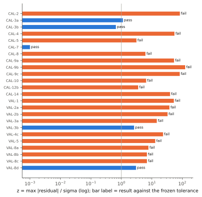

### 1.1 Calibration targets

| id | status | quantity | measured +- sigma | predicted (nominal) | band (corners) | z | tolerance | result | corners pass | flags |
|---|---|---|---|---|---|---|---|---|---|---|
| CAL-1 | active | loaded_q | [3500, 4200] | 3857 | [3857, 3860] | - | in [3500, 4200] | pass | 12/12 |  |
| CAL-2 | active | notch_depth_db | [27.9, 29.8, 29.8, 24.4, 22.1, 19.8] at heater_v [0, 0.2, 0.5, 0.8, 1, 1.2] +- 0.5 db | [27.89, 28.17, 29.75, 33.53, 39.19, 61.35] | nominal +- up to 43.67 | 83.1 | abs 1.5 | fail | 0/12 |  |
| CAL-3a | active | heater_power_per_fsr_mw | 25.45 +- 0.05 mw | 25.39 | [25.35, 25.39] | 1.12 | rel 0.02 | pass | 12/12 | R2 anchors P_FSR: close to the target by construction (replicas 4.6) |
| CAL-3b | active | heater_voltage_per_fsr_v | 1.195 +- 0.005 v | 1.192 | [1.171, 1.218] | 0.66 | rel 0.02 | pass | 12/12 | R2 anchors V_FSR: close to the target by construction |
| CAL-4 | active | resonance_shift_vs_heater_v_nm | [0.08, 0.29, 0.66, 1.16, 1.8, 2.55, 3.41, 4.37, ...] at heater_v [0.1, 0.2, 0.3, 0.4, 0.5, 0.6, 0.7, 0.8, ...] +- [0.04, 0.04, 0.06, 0.04, 0.04, 0.04, 0.06, 0.04, ...] nm | [0.08051, 0.321, 0.7185, 1.268, 1.965, 2.801, 3.771, 4.867, ...] | nominal +- up to 2.157 | 55.1 | abs 0.12 | fail | 0/12 |  |
| CAL-5 | active | resonance_shift_vs_reverse_bias_pm | [56.4, 66.8, 84.4] at bias_v [0.8, 1.2, 1.6] +- 5 pm | [40.76, 56.74, 71.4] | nominal +- up to 56 | 3.13 | abs 12 | fail | 0/12 |  |
| CAL-6 | active | dlambda_dt_printed_pm_per_k | 85.86 pm_per_k | 66.56 | [63.87, 74.33] | - | none | not scored (active) | - |  |
| CAL-7 | active | resonance_blue_offset_nm | 7.6 +- 0.1 nm | 7.6 | [7.6, 7.6] | 4.56e-05 | abs 0.3 | pass | 12/12 | R3 sets the cold offset: close to the target by construction |
| CAL-8 | active | drop_monitor_current_at_lock_ua | 15.5 +- 0.5 ua | 18.58 | [15.76, 46.65] | 6.16 | abs 1 | fail | 1/13 |  |
| CAL-9a | active | heater_code_swing_per_lane | [1.97e+04, 2.23e+04] +- 300 codes | [3625, 2.281e+04] | nominal +- up to 4699 | 53.6 | abs 900 | fail | 0/13 |  |
| CAL-9b | active | heater_code_lane_offset | {at_code_maxima: 7500, at_code_minima: 9500} +- {at_code_maxima: 200, at_code_minima: 400} codes | {at_code_maxima: 3.233e+04, at_code_minima: 3.802e+04} | nominal +- up to 1.088e+04 | 124 | abs 1200 | fail | 0/13 |  |
| CAL-9c | active | heater_code_range_all_lanes | [1.94e+04, 4.925e+04] +- 200 codes | [2932, 4.984e+04] | nominal +- up to 4793 | 82.3 | abs 600 | fail | 0/13 |  |
| CAL-10 | active | eo_bandwidth_3db_ghz | 30.9 +- 2 ghz | 43.92 | [43.9, 47.32] | 6.51 | abs 4 | fail | 0/12 |  |
| CAL-11 | active | pd_responsivity_a_per_w | [0.88, 1.04] a_per_w | [0.88, 1.012] | nominal +- up to 0 | - | in [0.88, 1.04] | pass | 12/12 |  |
| CAL-12a | active | laser_line_accuracy_ghz | 20 ghz | 20 | [20, 20] | - | <= 20 | pass | 13/13 |  |
| CAL-12b | active | laser_line_error_population_guide_ghz | {median: -2, q25: -5.5, q75: 1.5} +- {median: 1, q25: 1, q75: 1} ghz | {median: 0.2674, q25: -4.635, q75: 5.064} | nominal +- up to 0 | 3.56 | abs 2 | fail | 0/13 |  |
| CAL-12c | active | laser_wavelength_drift_24h_nm | 0.02 nm | 0.02026 | [0.02026, 0.02026] | - | <= 0.02 | fail | 0/13 |  |
| CAL-12d | active | laser_power_drift_24h_pct | 2.5 pct | 2.5 | [2.5, 2.5] | - | <= 2.5 | pass | 13/13 |  |
| CAL-13a | active | aggressor_trajectory_slide10 | rectified sine {t_max_c: 113.6, delta_t_k: 88.5, period_s: 0.1307} +- {t_max_c: 1, delta_t_k: 1, period_s: 0.001} c | <trajectory, 512 samples> | (trajectory) | - | rms <= 1 | pass | 13/13 | scenario calibration residual (small by construction), not a prediction |
| CAL-13b | active | aggressor_rate_808 | 808 k_per_s | 803 | [800.2, 807.3] | - | abs 80 | pass | 13/13 | scenario calibration residual (small by construction), not a prediction |
| CAL-14 | active | reloma_stabilized_low_bias_db | -2.1 +- 0.1 db | -6.069 | [-6.53, -6.06] | 39.7 | abs 0.3 | fail | 0/13 | relOMA = one MRM's through port over the power into it (07 D9); mrm.control.models reports OMA at the bus output: 0.35 dB lower (replicas 4.7) |

### 1.2 Validation targets

| id | status | quantity | measured +- sigma | predicted (nominal) | band (corners) | z | tolerance | result | corners pass | flags |
|---|---|---|---|---|---|---|---|---|---|---|
| VAL-1 | active | tuning_range_at_1p5v_nm | 13 +- 0.05 nm | 15.63 | [13.2, 15.64] | 52.7 | abs 0.7 | fail | 2/12 |  |
| VAL-2a | active | notch_depth_at_1p4v_db | 18 +- 0.5 db | 36.89 | [16.19, 43.98] | 37.8 | abs 1.5 | fail | 0/12 |  |
| VAL-2b | active | notch_depth_at_1p5v_db | 16.9 +- 0.5 db | 33.32 | [15.52, 37.99] | 32.8 | abs 1.5 | fail | 1/12 |  |
| VAL-3a | active | eo_bandwidth_at_2v_ghz | 35.4 +- 0.7 ghz | 45.57 | [45.47, 49.42] | 14.5 | abs 3 | fail | 0/12 |  |
| VAL-3b | active | eo_bandwidth_ratio_2v_over_1v | 1.09 +- 0.02 | 1.038 | [1.036, 1.044] | 2.61 | abs 0.06 | pass | 12/12 | replica method changed after the comparison was visible (replicas handoff 5): treat a pass as weak |
| VAL-4a | active | reloma_minus3db_contour_bias_at_0c_v | 3.15 +- 0.1 v | nan | [nan, nan] | - | abs 0.3 | fail | 0/13 | prediction not finite |
| VAL-4b | active | reloma_minus3db_contour_bias_at_105c_v | 3.4 +- 0.1 v | nan | [nan, nan] | - | abs 0.3 | fail | 0/13 | prediction not finite |
| VAL-4c | active | reloma_stabilized_spread_db | 0.9 +- 0.1 db | 3.233 | [3.233, 3.27] | 23.3 | abs 0.3 | fail | 0/13 | not independent of VAL-4a/b (the map maximum is the CAL-14 level): not counted as a third independent pass; shares its printed spread with BND-4 |
| VAL-5 | active | reloma_open_loop_contour_offsets_k | {levels_db: [-16, -24], below_peak_k: [7.6, 12.6], above_peak_k: [4.9, 9.4]} +- 0.7 k | {below_peak_k: [2.853, 6.972], above_peak_k: [10.52, 18.45]} | nominal +- up to 4.189 | 12.9 | offsets abs 2, cold_side_wider | fail | 0/13 |  |
| VAL-6 | deferred | stabilizer_code_excursion_0_105c | - codes | 2.483e+04 | [1.909e+04, 2.783e+04] | - | pending | not scored (deferred) | - | deferred until the DAC law and full scale are known (07 Q3); its data are CAL-9 |
| VAL-7a | unverified | group_index_published_geometry | 2.73 | 3.055 | [3.055, 3.055] | - | rel 0.03 | not scored (unverified; would be fail) | - | unverified: n_g 2.73 not re-read from de Cea 2019 (reported, not scored) |
| VAL-7b | active | confinement_factor_published_geometry | 0.65 | 0.8274 | [0.8274, 0.8274] | - | abs 0.05 | fail | 0/13 | definition conflict: energy fraction (primary) vs Robinson dn_eff/dn_Si (variant) (replicas 5) |
| VAL-7c | active | self_heating_time_constant_published | 0.45 +- 0.05 us | - | - | - | rel 0.5 | blocked | - |  |
| VAL-8a | active | heater_node_time_constant_published | 5 +- 0.5 us | 1.134 | [1.134, 1.134] | 7.73 | rel 0.3 | fail | 0/13 | a match of the interim thermal model with VAL-8 would be tautological; the replica reads the FEM extraction artefact |
| VAL-8b | active | waveguide_time_constant_published | 10 +- 1 us | 3.124 | [3.124, 3.124] | 6.88 | rel 0.3 | fail | 0/13 |  |
| VAL-8c | active | heater_efficiency_published_no_undercut_pm_per_mw | 222 +- 10 pm_per_mw | 290.9 | [290.9, 290.9] | 6.89 | rel 0.25 | fail | 0/13 |  |
| VAL-8d | active | heater_efficiency_published_full_undercut_pm_per_mw | 843 +- 55 pm_per_mw | 676.4 | [676.4, 676.4] | 3.03 | rel 0.3 | pass | 13/13 |  |
| VAL-8e | cross_check | foster_two_pole_fit_published | {tau1_us: 3.18, tau2_us: 13.01, share1_frac: 0.427, share2_frac: 0.573} | {tau1_us: 3.516, tau2_us: 32.67, share1_frac: 0.8734, share2_frac: 0.1266} | nominal +- up to 0 | - | rel 0.3 | not scored (cross_check; would be fail) | - | cross-check (solver against imec's FE fit), never counted as validation |

### 1.3 Bounds targets

| id | status | quantity | measured +- sigma | predicted (nominal) | band (corners) | z | tolerance | result | corners pass | flags |
|---|---|---|---|---|---|---|---|---|---|---|
| BND-1 | active | next_order_distance_fwhm | 2 | 2.792 | [1.331, 2.792] | - | >= 2 (hard 1) | pass | 11/13 | a soft_fail (1 to 2 FWHM) is marginal, not a pass |
| BND-2 | active | order_hop_margin_nm | 0 nm | 0.2828 | [-2.365, 1.135] | - | >= 0 | pass | 10/13 |  |
| BND-3a | active | aggressor_slide10_drop_error_band_pct | [-1.9, 3] +- 0.3 pct | - | - | - | band [-1.9, 3] slack 0.3 either sign | blocked | - |  |
| BND-3b | active | aggressor_808_monitor_deviation_ua | [-0.5, 0.5] ua | - | - | - | band [-0.5, 0.5] slack 0 | blocked | - |  |
| BND-4 | active | oracle_reloma_variation_over_t_db | 1 db | 0 | [0, 0.07407] | - | <= 1 | pass | 13/13 | shares the printed '< 1 dB' spread with VAL-4c |

Replica notes (assumptions and blocked reasons, per target)

- **CAL-3a**: ring.heater.p_fsr_mw (25.45 mW) is anchored by R2 with the FSR at the LINE wavelength (mrm.params.relations derived.optics.fsr_m); this protocol measures the FSR between the cold order and the next order red of it, so the two differ by the lambda^2 scaling of the FSR (-0.22 % here)
- **CAL-3b**: ring.heater.p_fsr_mw (25.45 mW) is anchored by R2 with the FSR at the LINE wavelength (mrm.params.relations derived.optics.fsr_m); this protocol measures the FSR between the cold order and the next order red of it, so the two differ by the lambda^2 scaling of the FSR (-0.22 % here)
- **CAL-10**: method changed at the 2026-10-09 review: the primary was the replica's own linearized index-only TCMT with R_source = 0 (variant 'method=linearized_index_only_r_source_0') while mrm.waveform did not exist; it is now the README's waveform mode with the plant's driver output resistance and the loss modulation. The change was made after the earlier predictions had been compared with CAL-10 / VAL-3 (5...
- **CAL-12b**: the model's line error population is variation.laser.line_offset_ghz of the preset (die and line sigma, clipped at the +-20 GHz requirement); no separate Guide model
- **CAL-13a**: CAL-13a is a scenario calibration: the power waveform is fitted to this target by mrm.scenarios, so the residual measures the calibration (and the waveform family), not a prediction
- **CAL-13b**: a scenario calibration (the A2 power is fitted to each reading); the one-sided sawtooth cannot be followed by a heater, so its residual is large by construction
- **VAL-3a**: method changed at the 2026-10-09 review: the primary was the replica's own linearized index-only TCMT with R_source = 0 (variant 'method=linearized_index_only_r_source_0') while mrm.waveform did not exist; it is now the README's waveform mode with the plant's driver output resistance and the loss modulation. The change was made after the earlier predictions had been compared with CAL-10 / VAL-3 (5...
- **VAL-3b**: VAL-3b: both biases at the same detuning rule (laser re-tuned at each bias)
- **VAL-3b**: method changed at the 2026-10-09 review: the primary was the replica's own linearized index-only TCMT with R_source = 0 (variant 'method=linearized_index_only_r_source_0') while mrm.waveform did not exist; it is now the README's waveform mode with the plant's driver output resistance and the loss modulation. The change was made after the earlier predictions had been compared with CAL-10 / VAL-3 (5...
- **VAL-4a**: the -3.0 dB contour is not reached between 1.0 and 4.0 V (map from -5.99 to -10.68 dB); the variant 'relative_to_low_bias_level' places it the printed 0.9 dB below the map's own low-bias level instead
- **VAL-4b**: the -3.0 dB contour is not reached between 1.0 and 4.0 V (map from -5.99 to -10.68 dB); the variant 'relative_to_low_bias_level' places it the printed 0.9 dB below the map's own low-bias level instead
- **VAL-5**: the ambient sweep direction of the loop-open map is not published; the primary is the up-sweep (from cold), chosen before any comparison. At this power the fixed-code line is hysteretic (bistable) between 66.00 and 68.00 degC (the two branches differ by up to 7.0 K of ring temperature); the 5 degC sampled offsets of both directions nevertheless agree, because no sample falls inside that window. Th...
- **VAL-7b**: VAL-7b definition conflict: the frozen target asks for an energy/power fraction; the extraction reads de Cea's Gamma as Robinson's dn_eff/dn_Si (variant)
- **VAL-7c**: no de Cea thermal stack in mrm/extraction/thermal_fem.py and no thermal_val7_decea.json
- **BND-3a**: controllers not registered yet: ['drop_setpoint_pi', 'bias_dither_lockin', 'dual_actuator_midrange'] (mrm/control/baselines)
- **BND-3b**: controllers not registered yet: ['drop_setpoint_pi', 'bias_dither_lockin', 'dual_actuator_midrange'] (mrm/control/baselines)

## 2. Closure and conflict table (07 4.6)

Published numbers that do not close through `derive()`. Each row is an open conflict; the model column shows what preset `g26` uses. CI keeps them visible through `xfail(strict=True, reason='VALIDATION.md#closure-<id>')` tests in `tests/closure/` (07 4.1); a row without a test is listed as such.

| id | quantity | conflicting evidence | model (this preset) | closure test |
|---|---|---|---|---|
| closure-dlambda-dt | dlambda/dT | 86 pm/K (printed aside) . 62.5 (Lightmatter bench, inferred) . 62.54 (imec, measured, O-band) . 66 to 69 at 25 degC and 74 to 77 at 105 degC (FEM plus expansion) . materials ceiling 71 to 80 . 50 (textbook, refuted) | 65.08 pm/K at 25 degC (hypothesis H_solver), 75.44 pm/K at the lock temperature 133.2 degC; CAL-6 apparent sensitivity 66.56 pm/K | none yet |
| closure-fsr | FSR | 10.3 nm (1.8 THz design) . < 11.44 nm (patent) . 8.7 to 8.8 nm (15 um diameter, wafer maps) . 9.0 to 9.3 nm (R = 7.5 um at the 160 nm film's n_g) . 11.2 nm (P_FSR x 0.44) . >= 14.1 nm (unsupported read-off) | 1.8 THz = 10.44 nm (hypothesis default) | none yet |
| closure-thickness | Waveguide thickness | 200 nm (SMTAI render) . 160 nm (45SPCLO photonics layer) | 160 nm (hypothesis 160) | none yet |
| closure-q | Q | 3500 (talk) . 3900 to 4200 (linewidth read-off) | Q_L 3850; CAL-1 replica 3857 | none yet |
| closure-heater-efficiency | Heater efficiency | 0.44 nm/mW (printed) . 0.405 (median at 10.3 nm) . 0.348 (swept device at 1.195 V) | 0.4102 nm/mW (R2 from P_FSR 25.45 mW and the FSR) | none yet |
| closure-rth | R_th | 4.7 K/mW under H86 . about 6.1 K/mW under H_solver . 2.9 to 11.4 K/mW across heater families | 5.696 K/mW (heater to ring, nominal world) | none yet |
| closure-reloma-level | relOMA level | -2.1 to -3.0 dB printed . -5.9 to -8.1 dB for a G25-like drive . requires 170 to 230 pm at Q 3500 | CAL-14 replica -6.069 dB | none yet |
| closure-reloma-curvature | relOMA curvature | k about 0.67 dB/degC^2 implies FWHM/(dlambda/dT) about 6 to 8 K only, in tension with Q 3500 and every dlambda/dT hypothesis unless the swing or Q differ (k is a secant, EXC-4) | FWHM / (dlambda/dT at lock) = 340.5 pm / 75.44 pm/K = 4.514 K | none yet |
| closure-aggressor-rate | Aggressor rate | 808 degC/s x 100 ms = 80.8 K (a mean rate) . slide-10 peak about 2200 degC/s (rectified sine: 2127) . a symmetric triangle would need 1600 degC/s | CAL-13b replica 803 K/s (scenario calibration) | none yet |
| closure-g25-topology | G25 TX topology | all-pass in the paper schematic . input/thru/drop micrograph on later slides | add-drop, kappa_d/kappa 0.007; the replicas also report the all-pass reading as a variant | none yet |
| closure-eo-bandwidth | EO bandwidth | 35.4 against 34.1 GHz at -2 V . 66.8 GHz (peaked, single device, generation unclear) | CAL-10 replica 43.92 GHz at 1 V, VAL-3a 45.57 GHz at 2 V | none yet |
| closure-rom-dc-scale | rom_dc_scale | reported per dlambda/dT hypothesis (07 P1-2) | not computed: the preset uses the interim thermal model (no FEM ROM) | none yet |
| closure-crosstalk-dynamics | Ring-to-ring crosstalk and far floor | imec, natural convection and an EIC on top (04 X1, X2): 3 % nearest, 1.3-2.6 % floor, first-order 4.1-9.0 ms poles at a 100 um pitch . in-ring FEM ROM, TEC-held package (R_pkg 2 K/W): 1.0 % at 50 um with t63 0.12 ms (0.36 ms at 100 um; not first order, 90 % at 2.7 ms), 0.17-0.34 % at 150-350 um, 0.09 % at 1 mm . the G26 package is unpublished (physics_thermal review 2026-10-16) | interim, stack hypothesis side_by_side: ring 1 -> ring 0 at 50 um: 2.99 % with a 1.521 ms pole (heat-source-to-victim distance law); far-site floor 1.5 % of Z_heater->ring; corner g26_tec_package: the FEM-like numbers | `tests/closure/test_thermal_crosstalk.py::test_g26_default_crosstalk_matches_the_fem_rom` |

12 of 13 rows have no xfail(strict=True) closure test yet (requested in docs/handoff/integrator.md section 9.4).

## 3. Identifiability of the calibration parameters

Jacobian of the calibration replicas (calibration targets only; the scenario calibrations laser_line_statistics, aggressor_trajectory and the never-fitted CAL-6 left out) with respect to 18 candidate parameters of 07 4.3, by central differences of 5 % of each prior range (one-sided at a range end), at the preset's values. Entries are normalized: residual sigmas (the target sigma; a quarter of an interval tolerance or half an abs/rel tolerance where no sigma is printed) per prior half-width (the leaf's `range`). In these units the 07 4.3 half-prior rule (95 % interval at most half the prior range) is 1.96 sigma <= 0.5, i.e. a direction is identified when its singular value is at least 3.92.

This is a local, linearized screen at a point that is not a fit (the preset is uncalibrated): a parameter that fails it cannot be tagged `calibrated` from these targets; one that passes still needs the profile likelihood of 07 4.3 (below). The screen works in linear coordinates of each range and fits all candidates jointly; the calibration task applies the rule to profile intervals per group, in log coordinates for a log-scale parameter, so its verdicts can differ.

Residuals used: 38 (dropped as non-finite: 0); rank 17 of 18; condition number 2.353e+16; directions passing the rule: 14 of 18.

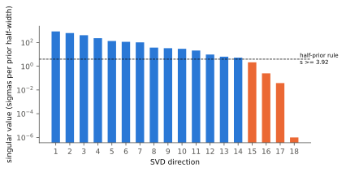

| k | singular value | rule | largest loadings |
|---|---|---|---|
| 1 | 857 | identified | dln_alpha_dt_heater_per_k -0.63, p_fsr_mw +0.45, heater_self_ratio +0.39, kappa_d_over_kappa -0.30 |
| 2 | 626 | identified | kappa_d_over_kappa +0.65, q_loaded +0.59, alpha_other_abs_db_per_cm +0.33, p_fsr_mw +0.22 |
| 3 | 411 | identified | kappa_d_over_kappa +0.68, q_loaded -0.68, alpha_other_abs_db_per_cm -0.22, dln_alpha_dt_heater_per_k -0.11 |
| 4 | 231 | identified | dln_alpha_dt_heater_per_k +0.71, tcr_per_k +0.42, heater_self_ratio +0.28, p_fsr_mw +0.27 |
| 5 | 134 | identified | resonance_offset_nm -0.77, alpha_other_abs_db_per_cm +0.49, q_loaded -0.23, p_fsr_mw +0.22 |
| 6 | 114 | identified | alpha_other_abs_db_per_cm -0.64, resonance_offset_nm -0.61, tcr_per_k +0.26, q_loaded +0.24 |
| 7 | 103 | identified | p_fsr_mw -0.78, alpha_other_abs_db_per_cm +0.36, heater_self_ratio +0.34, tcr_per_k +0.28 |
| 8 | 37.1 | identified | full_scale_v +0.98, r_cold_ohm +0.13, resonance_offset_nm +0.09, heater_self_ratio +0.06 |
| 9 | 33.3 | identified | chip_input_loss_db -0.78, swing_pp_v +0.55, eff_at_0v_pm_per_v +0.22, r_cold_ohm -0.11 |
| 10 | 29.6 | identified | swing_pp_v +0.71, chip_input_loss_db +0.56, eff_at_0v_pm_per_v +0.39, r_cold_ohm +0.10 |
| 11 | 21.1 | identified | r_cold_ohm +0.90, tcr_per_k -0.28, heater_self_ratio -0.27, chip_input_loss_db -0.15 |
| 12 | 9.73 | identified | heater_self_ratio +0.72, tcr_per_k -0.66, dln_alpha_dt_heater_per_k +0.14, alpha_other_abs_db_per_cm -0.12 |
| 13 | 6.36 | identified | series_resistance_ohm +0.84, capacitance_at_0v_ff +0.53, chip_input_loss_db +0.14, heater_self_ratio +0.02 |
| 14 | 5.29 | identified | eff_at_0v_pm_per_v -0.90, swing_pp_v +0.44, gain_scale -0.06, chip_input_loss_db +0.06 |
| 15 | 2.13 | not identified | responsivity_a_per_w +1.00, alpha_other_abs_db_per_cm +0.01, eff_at_0v_pm_per_v -0.01, kappa_d_over_kappa -0.01 |
| 16 | 0.252 | not identified | gain_scale -0.99, alpha_other_abs_db_per_cm -0.08, kappa_d_over_kappa +0.06, eff_at_0v_pm_per_v +0.05 |
| 17 | 0.038 | not identified | capacitance_at_0v_ff +0.84, series_resistance_ohm -0.54, chip_input_loss_db +0.05, gain_scale +0.02 |
| 18 | 3.64e-14 | not identified | fill_fraction +1.00, capacitance_at_0v_ff +0.00, series_resistance_ohm -0.00, gain_scale +0.00 |

| parameter | meant to explain | prior range | value | column norm | linearized 95 % interval / prior range | half-prior rule | provenance |
|---|---|---|---|---|---|---|---|
| `ring.optics.q_loaded` | CAL-1 | [2600, 4200] | 3850 | 477 | 0.0695 | pass | inferred |
| `ring.optics.loss_budget.alpha_other_abs_db_per_cm` | CAL-2 (coupling branch) | [0, 30] | 13.35 | 260 | 0.607 | fail | assumed |
| `ring.optics.kappa_d_over_kappa` | CAL-2 (coupling branch) | [0.004, 0.18] | 0.007 | 556 | 0.471 | pass | inferred |
| `ring.optics.dln_alpha_dt_heater_per_k` | CAL-2 (ER mechanism) | [0, 0.005] | 0 | 570 | 0.0627 | pass | assumed |
| `ring.heater.p_fsr_mw` | CAL-3a | [24.9, 37] | 25.45 | 422 | 0.0162 | pass | printed |
| `ring.heater.r_cold_ohm` | CAL-3b | [42, 58] | 45.41 | 209 | 0.0857 | pass | inferred |
| `ring.heater.tcr_per_k` | CAL-4 (droop) | [5.000e-04, 0.0045] | 0.0014 | 293 | 0.277 | pass | literature |
| `ring.thermal.heater_self_ratio` | CAL-4 (droop) | [1, 4] | 1.158 | 364 | 0.301 | pass | inferred |
| `ring.junction.fill_fraction` | CAL-5 | [0.5, 0.95] | 0.8 | 1.25e-13 | inf | fail | assumed |
| `ring.junction.eff_at_0v_pm_per_v` | CAL-5 | [50, 95] | 72.5 | 14.3 | 0.523 | fail | inferred |
| `ring.optics.resonance_offset_nm` | CAL-7 | [5, 10] | 7.6 | 133 | 0.0284 | pass | inferred |
| `ring.monitor.gain_scale` | CAL-8 | [0.5, 2] | 1 | 27.9 | 7.8 | fail | assumed |
| `optical_path.chip_input_loss_db` | CAL-8, CAL-14 (power at the ring) | [2, 10] | 6 | 46.7 | 2.5 | fail | inferred |
| `ring.heater.full_scale_v` | CAL-9 (DAC LSB under the voltage law) | [1.4, 1.8] | 1.6 | 40.2 | 0.0633 | pass | assumed |
| `ring.junction.series_resistance_ohm` | CAL-10 | [15, 390] | 100 | 6.16 | 27.8 | fail | assumed |
| `ring.junction.capacitance_at_0v_ff` | CAL-10 | [6, 30] | 15 | 5.1 | 43.4 | fail | assumed |
| `driver.swing_pp_v` | CAL-14 | [0.9, 2.6] | 1.3 | 28.1 | 0.275 | pass | printed |
| `ring.monitor.responsivity_a_per_w` | CAL-11, CAL-8 | [0.88, 1.04] | 0.95 | 3.78 | 0.92 | fail | printed |

Moved on the G26 plant only (the other plant's leaf has another value, so it is a different physical quantity there; its targets get a zero column): `optical_path.chip_input_loss_db` (g25_test_vehicle has 0 (G26 6): not moved).

Base point (the preset's values): CAL-1 pass, CAL-2 fail (z 83.1), CAL-3a pass (z 1.12), CAL-3b pass (z 0.66), CAL-4 fail (z 55.1), CAL-5 fail (z 3.13), CAL-7 pass (z 4.56e-05), CAL-8 fail (z 6.16), CAL-9a fail (z 53.6), CAL-9b fail (z 124), CAL-9c fail (z 82.3), CAL-10 fail (z 6.51), CAL-11 pass, CAL-14 fail (z 39.7).

No calibration target responds to `ring.junction.fill_fraction` in this preset (a zero Jacobian column): it cannot be calibrated from these targets at all.

Failing the linearized half-prior rule (all 18 fitted jointly): `ring.optics.loss_budget.alpha_other_abs_db_per_cm`, `ring.junction.fill_fraction`, `ring.junction.eff_at_0v_pm_per_v`, `ring.monitor.gain_scale`, `optical_path.chip_input_loss_db`, `ring.junction.series_resistance_ohm`, `ring.junction.capacitance_at_0v_ff`, `ring.monitor.responsivity_a_per_w`. They keep `assumed` (or their current provenance) with a range unless another target is added.

Caution: CAL-2, CAL-4, CAL-9a, CAL-9b, CAL-9c, CAL-14 miss by more than 10 sigma at this point, so the largest singular values describe the slope far from any fit (CAL-2 also crosses critical coupling, where the notch depth is not smooth). The linearization says which combinations the targets constrain, not the values a fit would reach; a model-form error (a target no parameter value can reach) shows up as a large residual that survives the fit, not here.

### 3.1 Profile likelihoods (calibration task)

From `mrm/calibration/latest_fit.json` (schema `mrm.calibration.fit/1`, created 2026-10-16T02:43:48Z, commit `b92c519` with uncommitted changes). Every target id the fit used (group targets, per-hypothesis residual targets, leaf decisions) is checked against the frozen split.

**Group `heater`** (nominal hypothesis `same_rth_heater`, best `H86/same_ratio`). Targets: CAL-3a, CAL-3b, CAL-4. Audit: ok (calibration ids only).

| hypothesis | chi2 | dof | Birge ratio^2 | delta chi2 | likelihood ratio (Birge) | delta AIC |
|---|---|---|---|---|---|---|
| H86/same_ratio | 0.4598 | 11 | 1 | 0 | 1 | 0 |
| H86/same_rth_heater | 0.4598 | 11 | 1 | 7.415e-09 | 1 | 7.415e-09 |
| same_ratio | 3.266 | 11 | 1 | 2.806 | 0.2459 | 2.806 |
| same_rth_heater | 3.266 | 11 | 1 | 2.806 | 0.2459 | 2.806 |

thermo-optic world x droop transfer from the swept device to the median device (CAL-4 vs CAL-3)

| leaf | scope | value (was) | provenance (was) | 95 % profile hull | prior | width / prior | rule | unique | targets |
|---|---|---|---|---|---|---|---|---|---|
| `ring.heater.p_fsr_mw` | device | 25.51 (25.45) | calibrated (printed) | [25.41, 25.6] | [24.9, 37] | 0.0162 | calibrated: 95 % profile hull within half the prior, closed, one interval | False | [CAL-3a, CAL-3b, CAL-4] |
| `ring.heater.r_cold_ohm` | device | 41.29 (45.41) | calibrated (inferred) | [38.76, 42.68] | [35, 58] | 0.245 | calibrated: 95 % profile hull within half the prior, closed, one interval | False | [CAL-3a, CAL-3b, CAL-4] |
| `ring.thermal.heater_self_ratio` | device | 1.796 (1.158) | calibrated (inferred) | [1.593, 2.195] | [1, 4] | 0.201 | calibrated: 95 % profile hull within half the prior, closed, one interval | False | [CAL-3a, CAL-3b, CAL-4] |

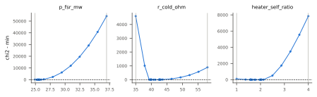

**Group `coupling_er`** (nominal hypothesis `under/dispersion/floor`, best `over/ring_t_loss/floor`). Targets: CAL-1, CAL-2. Audit: ok (calibration ids only).

| hypothesis | chi2 | dof | Birge ratio^2 | delta chi2 | likelihood ratio (Birge) | delta AIC |
|---|---|---|---|---|---|---|
| over/ring_t_loss/floor | 7.508 | 2 | 3.754 | 0 | 1 | 0 |
| over/heater_t_loss/floor | 7.508 | 2 | 3.754 | 2.562e-04 | 1 | 2.562e-04 |
| under/dispersion/floor | 10.52 | 2 | 5.259 | 3.01 | 0.6697 | 3.01 |
| over/dispersion/floor | 20.81 | 2 | 10.41 | 13.31 | 0.1699 | 13.31 |
| under/heater_t_loss/floor | 23.11 | 2 | 11.55 | 15.6 | 0.1253 | 15.6 |
| under/ring_t_loss/floor | 23.11 | 2 | 11.55 | 15.6 | 0.1252 | 15.6 |
| over/dispersion | 49.81 | 3 | 16.6 | 42.3 | 0.003572 | 40.3 |
| under/heater_t_loss | 57.32 | 3 | 19.11 | 49.82 | 0.001314 | 47.82 |
| under/ring_t_loss | 57.32 | 3 | 19.11 | 49.82 | 0.001313 | 47.82 |
| over/ring_t_loss | 74.92 | 3 | 24.97 | 67.41 | 1.261e-04 | 65.41 |
| over/heater_t_loss | 305.6 | 3 | 101.9 | 298 | 5.747e-18 | 296 |
| under/dispersion | 342.1 | 3 | 114 | 334.6 | 4.429e-20 | 332.6 |

branch x extinction mechanism x instrument floor (07 P1-5)

| leaf | scope | value (was) | provenance (was) | 95 % profile hull | prior | width / prior | rule | unique | targets |
|---|---|---|---|---|---|---|---|---|---|
| `ring.optics.q_loaded` | device | 3850 (3850) | inferred (inferred) | [3469, 4200] | [2600, 4200] | 0.457 | kept: interval reaches the prior bound (open) | False | [CAL-1, CAL-2] |
| `ring.optics.loss_budget.alpha_other_abs_db_per_cm` | device | 10.72 (13.35) | assumed (assumed) | [0, 24.23] | [0, 30] | 0.808 | kept: width 0.81 of the prior > 0.5; interval reaches the prior bound (open) | False | [CAL-1, CAL-2] |
| `ring.optics.dln_kappa2_through_dlambda_per_nm` | device | 0.02225 (0.00767) | assumed (solver(assumed-geometry)) | [0.008772, 0.02834] | [0, 0.04] | 0.489 | kept: no declared prior range (fit bounds only), so the half-prior rule cannot apply | False | [CAL-1, CAL-2] |
| `ring.optics.dln_alpha_dt_ring_per_k` | device | 0 (0) | assumed (assumed) | - | - | - | the leaf value is not fitted; see its alternatives | - | [CAL-1, CAL-2] |
| `ring.optics.dln_alpha_dt_heater_per_k` | device | 0 (0) | assumed (assumed) | - | - | - | the leaf value is not fitted; see its alternatives | - | [CAL-1, CAL-2] |

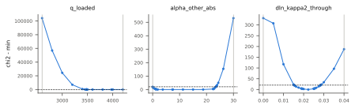

**Group `offset`** (nominal hypothesis `cold_cavity`, best `cold_cavity`). Targets: CAL-7. Audit: ok (calibration ids only).

| hypothesis | chi2 | dof | Birge ratio^2 | delta chi2 | likelihood ratio (Birge) | delta AIC |
|---|---|---|---|---|---|---|
| cold_cavity | 1.322e-20 | 1 | 1 | 0 | 1 | 0 |

| leaf | scope | value (was) | provenance (was) | 95 % profile hull | prior | width / prior | rule | unique | targets |
|---|---|---|---|---|---|---|---|---|---|
| `ring.optics.resonance_offset_nm` | device | 7.6 (7.6) | calibrated (inferred) | [7.404, 7.796] | [5, 10] | 0.0784 | calibrated: 95 % profile hull within half the prior, closed, one interval | True | [CAL-7] |

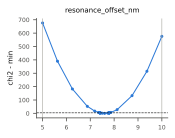

**Group `junction`** (nominal hypothesis `analytic/p_in_4dbm`, best `analytic/p_in_4dbm`). Targets: CAL-5. Audit: ok (calibration ids only).

| hypothesis | chi2 | dof | Birge ratio^2 | delta chi2 | likelihood ratio (Birge) | delta AIC |
|---|---|---|---|---|---|---|
| analytic/p_in_4dbm | 2.096 | 2 | 1.048 | 0 | 1 | 0 |
| analytic/p_in_0 | 2.714 | 2 | 1.357 | 0.6181 | 0.7446 | 0.6181 |

measurement power of the G25 bias ladder

| leaf | scope | value (was) | provenance (was) | 95 % profile hull | prior | width / prior | rule | unique | targets |
|---|---|---|---|---|---|---|---|---|---|
| `ring.junction.eff_at_0v_pm_per_v` | device | 93.64 (72.5) | inferred (inferred) | [65.69, 95] | [50, 95] | 0.651 | kept: width 0.65 of the prior > 0.5; interval reaches the prior bound (open); 2 disjoint intervals across hypotheses | False | [CAL-5] |
| `ring.junction.fill_fraction` | device | 0.8 (0.8) | assumed (assumed) | [0.7932, 0.95] | [0.5, 0.95] | 0.348 | kept: interval reaches the prior bound (open) | False | [CAL-5] |

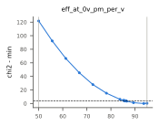

**Group `eo`** (nominal hypothesis `rs_free`, best `both_free`). Targets: CAL-10. Audit: ok (calibration ids only).

| hypothesis | chi2 | dof | Birge ratio^2 | delta chi2 | likelihood ratio (Birge) | delta AIC |
|---|---|---|---|---|---|---|
| both_free | 1.306e-19 | 1 | 1 | 0 | 1 | 0 |
| rs_free | 0.4434 | 1 | 1 | 0.4434 | 0.8012 | -1.557 |
| c_free | 18.45 | 1 | 18.45 | 18.45 | 9.839e-05 | 16.45 |

which of R_s and C_j carries the R C

| leaf | scope | value (was) | provenance (was) | 95 % profile hull | prior | width / prior | rule | unique | targets |
|---|---|---|---|---|---|---|---|---|---|
| `ring.junction.series_resistance_ohm` | device | 390 (100) | assumed (assumed) | [142.8, 390] | [15, 390] | 0.308 | kept: interval reaches the prior bound (open) | False | [CAL-10] |

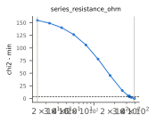

**Group `monitor`** (nominal hypothesis `setpoint=half_max`, best `setpoint=oracle`). Targets: CAL-8. Audit: ok (calibration ids only).

| hypothesis | chi2 | dof | Birge ratio^2 | delta chi2 | likelihood ratio (Birge) | delta AIC |
|---|---|---|---|---|---|---|
| setpoint=oracle | 9.528e-19 | 1 | 1 | 0 | 1 | 0 |
| setpoint=half_max | 1.444e-16 | 1 | 1 | 1.434e-16 | 1 | 0 |
| setpoint=peak | 43.57 | 1 | 43.57 | 43.57 | 3.452e-10 | 43.57 |

lock set-point of the G26 loop

| leaf | scope | value (was) | provenance (was) | 95 % profile hull | prior | width / prior | rule | unique | targets |
|---|---|---|---|---|---|---|---|---|---|
| `ring.monitor.gain_scale` | system | 0.8243 (1) | assumed (assumed) | [0.5, 0.8764] | [0.5, 2] | 0.405 | kept: interval reaches the prior bound (open); 2 disjoint intervals across hypotheses | False | [CAL-8] |

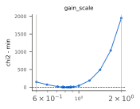

**Group `modulation_depth`** (nominal hypothesis `mode=oracle`, best `mode=oracle`). Targets: CAL-14. Audit: ok (calibration ids only).

| hypothesis | chi2 | dof | Birge ratio^2 | delta chi2 | likelihood ratio (Birge) | delta AIC |
|---|---|---|---|---|---|---|
| mode=oracle | 18.89 | 1 | 18.89 | 0 | 1 | 0 |
| mode=setpoint_lock | 426.6 | 1 | 426.6 | 407.7 | 2.055e-05 | 407.7 |

lock mode of the relOMA map

| leaf | scope | value (was) | provenance (was) | 95 % profile hull | prior | width / prior | rule | unique | targets |
|---|---|---|---|---|---|---|---|---|---|
| `driver.swing_pp_v` | system | 1.3 (1.3) | printed (printed) | [2.257, 2.6] | [0.9, 2.6] | 0.202 | kept: interval reaches the prior bound (open) | False | [CAL-14] |

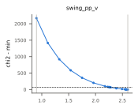

**Group `dac`** (nominal hypothesis `voltage/H_solver/temperature`, best `voltage/H_solver/temperature`). Targets: CAL-9a, CAL-9b, CAL-9c. Audit: ok (calibration ids only).

| hypothesis | chi2 | dof | Birge ratio^2 | delta chi2 | likelihood ratio (Birge) | delta AIC |
|---|---|---|---|---|---|---|
| voltage/H_solver/temperature | 254.3 | 3 | 84.78 | 0 | 1 | 0 |
| voltage/H_solver/resonance | 597.3 | 3 | 199.1 | 343 | 0.1323 | 343 |
| voltage/H86/temperature | 1.297e+04 | 3 | 4323 | 1.272e+04 | 2.684e-33 | 1.272e+04 |
| voltage/H86/resonance | 1.474e+04 | 3 | 4913 | 1.448e+04 | 7.928e-38 | 1.448e+04 |

thermo-optic hypothesis x aggressor referencing (07 D2, D6)

| leaf | scope | value (was) | provenance (was) | 95 % profile hull | prior | width / prior | rule | unique | targets |
|---|---|---|---|---|---|---|---|---|---|
| `ring.heater.full_scale_v` | system | 1.6 (1.6) | assumed (assumed) | [1.4, 1.536] | [1.4, 1.8] | 0.339 | kept: interval reaches the prior bound (open) | False | [CAL-9a, CAL-9b, CAL-9c] |
| `variation.geometry.ring_sigma_scale` | system | 1 (1) | assumed (assumed) | [0.2, 0.4248] | [0, 1.5] | 0.15 | kept: no declared prior range (fit bounds only), so the half-prior rule cannot apply | False | [CAL-9a, CAL-9b, CAL-9c] |

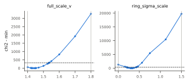

**Group `laser`** (nominal hypothesis `gaussian_die_plus_line`, best `gaussian_die_plus_line`). Targets: CAL-12b. Audit: ok (calibration ids only).

| hypothesis | chi2 | dof | Birge ratio^2 | delta chi2 | likelihood ratio (Birge) | delta AIC |
|---|---|---|---|---|---|---|
| gaussian_die_plus_line | 9.813e-04 | 1 | 1 | 0 | 1 | 0 |

| leaf | scope | value (was) | provenance (was) | 95 % profile hull | prior | width / prior | rule | unique | targets |
|---|---|---|---|---|---|---|---|---|---|
| `laser.line_offset_ghz` | system | -2.167 (0) | calibrated (assumed) | [-3.301, -1.034] | [-20, 20] | 0.0567 | calibrated: 95 % profile hull within half the prior, closed, one interval | True | [CAL-12b] |
| `variation.laser.line_offset_ghz.sigma_scale` | system | 0.7217 (1) | inferred (inferred) | [0.4359, 1.007] | [0.25, 2] | 0.403 | kept: no declared prior range (fit bounds only), so the half-prior rule cannot apply | False | [CAL-12b] |

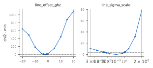

Calibration notes: groups heater, coupling_er run 2026-10-16T02:43:48Z; groups offset ... laser run 2026-10-16T02:49:31Z in parallel on the identical heater and coupling_er leaves (checked); review of the calibration stage (uncommitted changes on top of the commit); review: the heater fits' derived 'thermo_optic' label was corrected after the run (a late-binding closure printed H86 for every hypothesis; the derived numbers used the right world); integrator (calibration stage, 2026-10-16): context.device rebuilt from the leaf decisions (pipeline.context_from_decisions); the merged record had kept the pre-review values of resonance_offset_nm 7.6000046 (fitted 7.6000052), eff_at_0v_pm_per_v 93.864 (fitted 93.643) and series_resistance_ohm (equal to 1e-11); the before/after table was rerun on the repaired context; no fit and no preset value changed

### 3.2 Leaves tagged `calibrated` in this preset

None: preset `g26` has no `calibrated` leaf.

## 4. Uncertainty propagation (07 4.8 set)

Performance is conditional on the assumed thermal dynamics (heater, crosstalk and aggressor poles) until Q1 (the heater step response at the lock point, 07 section 5) is answered.

Protocol: controller `pi_lock_c` under a1 (one 130.7 ms period, 5 ms start-up), warm start, self reference, metrics only (the compare_locks protocol of 07 4.8 for one controller), variation off (epistemic worlds only). Every world is one row of a u-design injected into `realize(..., uncertainty='lhs')` and checked against realize's draws (`mrm.validation.sensitivity`). The tornado moves one entry at a time to its interval ends or to each reachable hypothesis choice (stress choices with zero weight are corners, not part of the sampled set), all other entries at nominal; the base world is the nominal world (a nominal at an interval end becomes 1e-12 of the range from it). The top 8 entries by normalized swing (largest swing over the metrics, each metric normalized by its largest finite swing) then get Saltelli (2010) first-order and Jansen total Sobol indices over their prior (u-space; hypotheses by their weights), the other entries held at nominal, so the indices are conditional on those. Bootstrap intervals: 95 %, 500 resamples. Noise seeds differ by world index (world b uses base + b), so a Saltelli row and its AB_i partner also differ in noise: the nominal world rerun with 8 other noise seeds gives the noise variance of each metric below; its share of the output variance is added to every ST (and is the smallest ST that means anything).

Cost: 46 tornado worlds + 1280 Sobol worlds (128 base rows x (8 + 2)), at most 256 worlds per Plant, 4 kernel threads; wall 1519 s (Sobol part 1485 s), peak RSS 0.78 GB of the report process.

Tornado worlds that start supply-limited (the bank cannot hold every lock at the warm start, experiments handoff): `thermal.stack:stacked_eic`.

Fraction of Sobol worlds that start supply-limited: 0.296.

Nominal world: oma_penalty_db_worst 0.3159, excursion_count 4, excursion_max_s 0.01379, wrong_line_rings 0, unlocked_rings 0, mean_reloma_db -6.18.

### 4.1 Tornado (one entry at a time)

**oma_penalty_db_worst** (nominal 0.3159 dB)

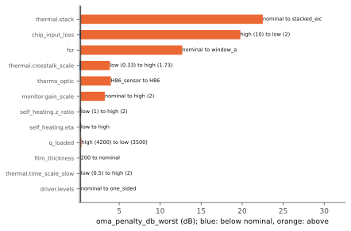

| entry | low end | high end | swing |
|---|---|---|---|
| `thermal.stack` | 0.3159 (nominal) | 22.52 (stacked_eic) | 22.2 |
| `chip_input_loss` | 0.1832 (high (10)) | 19.77 (low (2)) | 19.59 |
| `fsr` | 0.3159 (nominal) | 12.7 (window_a) | 12.38 |
| `thermal.crosstalk_scale` | 0.1635 (low (0.33)) | 3.865 (high (1.73)) | 3.702 |
| `thermo_optic` | 0.3158 (H86_sensor) | 3.984 (H86) | 3.668 |
| `monitor.gain_scale` | 0.3159 (nominal) | 3.246 (high (2)) | 2.93 |
| `self_heating.z_ratio` | 0.2129 (low (1)) | 0.3505 (high (2)) | 0.1376 |
| `self_heating.eta` | 0.2175 (low) | 0.3462 (high) | 0.1287 |
| `q_loaded` | 0.3047 (high (4200)) | 0.3966 (low (3500)) | 0.09199 |
| `film_thickness` | 0.2957 (200) | 0.3159 (nominal) | 0.02021 |
| `thermal.time_scale_slow` | 0.3093 (low (0.5)) | 0.3284 (high (2)) | 0.01913 |
| `driver.levels` | 0.3159 (nominal) | 0.3329 (one_sided) | 0.01704 |
| (13 more entries) | | | <= 0.01613 |

**excursion_count** (nominal 4 )

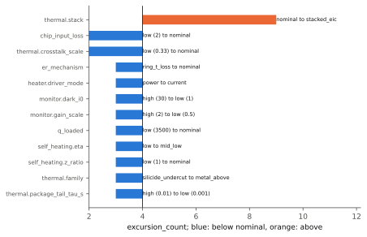

| entry | low end | high end | swing |
|---|---|---|---|
| `thermal.stack` | 4 (nominal) | 10 (stacked_eic) | 6 |
| `fsr` | 0 (window_a) | 4 (nominal) | 4 |
| `chip_input_loss` | 2 (low (2)) | 4 (nominal) | 2 |
| `q_loaded` | 2 (high (4200)) | 4 (low (3500)) | 2 |
| `thermal.crosstalk_scale` | 2 (low (0.33)) | 4 (nominal) | 2 |
| `er_mechanism` | 3 (heater_t_loss) | 4 (ring_t_loss) | 1 |
| `film_thickness` | 3 (200) | 4 (nominal) | 1 |
| `heater.driver_mode` | 3 (power) | 4 (current) | 1 |
| `monitor.dark_i0` | 3 (high (30)) | 4 (low (1)) | 1 |
| `self_heating.eta` | 3 (low) | 4 (nominal) | 1 |
| `self_heating.z_ratio` | 3 (low (1)) | 4 (nominal) | 1 |
| `thermal.family` | 3 (silicide_undercut) | 4 (metal_above) | 1 |
| (1 more entries) | | | <= 1 |

No change of excursion_count when moved alone (the others at nominal): `aggressor.referencing`, `aggressor.waveform`, `coupling_regime`, `driver.levels`, `monitor.gain_scale`, `thermal.package_tail_share_frac`, `thermal.package_tail_tau_s`, `thermal.scaling`, `thermal.time_scale_fast`, `thermal.time_scale_slow`, `thermal.transport_delay_s`, `timing.latency_scale`.

**excursion_max_s** (nominal 0.01379 s)

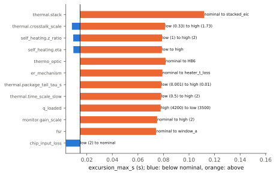

| entry | low end | high end | swing |
|---|---|---|---|
| `thermal.stack` | 0.01379 (nominal) | 0.1115 (stacked_eic) | 0.0977 |
| `thermal.crosstalk_scale` | 0.007283 (low (0.33)) | 0.08078 (high (1.73)) | 0.0735 |
| `thermo_optic` | 0.01379 (nominal) | 0.08177 (H86) | 0.06798 |
| `fsr` | 0 (window_a) | 0.01379 (nominal) | 0.01379 |
| `chip_input_loss` | 0.002677 (low (2)) | 0.01379 (nominal) | 0.01112 |
| `self_heating.z_ratio` | 0.00828 (low (1)) | 0.01564 (high (2)) | 0.007356 |
| `self_heating.eta` | 0.008402 (low) | 0.01544 (high) | 0.007037 |
| `monitor.gain_scale` | 0.007099 (high (2)) | 0.01381 (low (0.5)) | 0.006715 |
| `er_mechanism` | 0.01379 (nominal) | 0.0157 (heater_t_loss) | 0.00191 |
| `film_thickness` | 0.01269 (200) | 0.01379 (nominal) | 0.001106 |
| `thermal.time_scale_slow` | 0.01363 (low (0.5)) | 0.01416 (high (2)) | 5.240e-04 |
| `thermal.package_tail_tau_s` | 0.01373 (low (0.001)) | 0.0142 (high (0.01)) | 4.760e-04 |
| (13 more entries) | | | <= 4.220e-04 |

**wrong_line_rings** (nominal 0 rings)

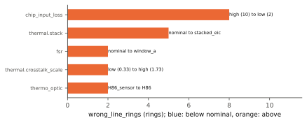

| entry | low end | high end | swing |
|---|---|---|---|
| `chip_input_loss` | 0 (high (10)) | 8 (low (2)) | 8 |
| `thermal.stack` | 0 (nominal) | 5 (stacked_eic) | 5 |
| `fsr` | 0 (nominal) | 2 (window_a) | 2 |
| `thermal.crosstalk_scale` | 0 (low (0.33)) | 2 (high (1.73)) | 2 |
| `thermo_optic` | 0 (H86_sensor) | 2 (H86) | 2 |

No change of wrong_line_rings when moved alone (the others at nominal): `aggressor.referencing`, `aggressor.waveform`, `coupling_regime`, `driver.levels`, `er_mechanism`, `film_thickness`, `heater.driver_mode`, `monitor.dark_i0`, `monitor.gain_scale`, `q_loaded`, `self_heating.eta`, `self_heating.z_ratio`, `thermal.family`, `thermal.package_tail_share_frac`, `thermal.package_tail_tau_s`, `thermal.scaling`, `thermal.time_scale_fast`, `thermal.time_scale_slow`, `thermal.transport_delay_s`, `timing.latency_scale`.

**unlocked_rings** (nominal 0 rings)

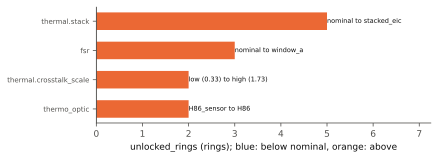

| entry | low end | high end | swing |
|---|---|---|---|
| `thermal.stack` | 0 (nominal) | 5 (stacked_eic) | 5 |
| `fsr` | 0 (nominal) | 3 (window_a) | 3 |
| `thermal.crosstalk_scale` | 0 (low (0.33)) | 2 (high (1.73)) | 2 |
| `thermo_optic` | 0 (H86_sensor) | 2 (H86) | 2 |

No change of unlocked_rings when moved alone (the others at nominal): `aggressor.referencing`, `aggressor.waveform`, `chip_input_loss`, `coupling_regime`, `driver.levels`, `er_mechanism`, `film_thickness`, `heater.driver_mode`, `monitor.dark_i0`, `monitor.gain_scale`, `q_loaded`, `self_heating.eta`, `self_heating.z_ratio`, `thermal.family`, `thermal.package_tail_share_frac`, `thermal.package_tail_tau_s`, `thermal.scaling`, `thermal.time_scale_fast`, `thermal.time_scale_slow`, `thermal.transport_delay_s`, `timing.latency_scale`.

**mean_reloma_db** (nominal -6.18 dB)

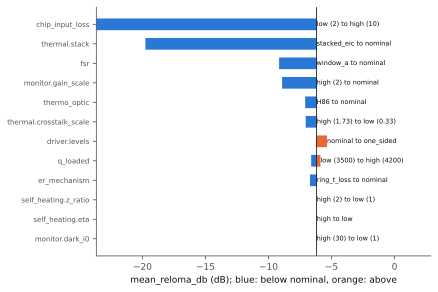

| entry | low end | high end | swing |
|---|---|---|---|
| `chip_input_loss` | -23.67 (low (2)) | -6.166 (high (10)) | 17.5 |
| `thermal.stack` | -19.76 (stacked_eic) | -6.18 (nominal) | 13.58 |
| `fsr` | -9.157 (window_a) | -6.18 (nominal) | 2.977 |
| `monitor.gain_scale` | -8.905 (high (2)) | -6.18 (nominal) | 2.725 |
| `thermo_optic` | -7.088 (H86) | -6.18 (nominal) | 0.9081 |
| `thermal.crosstalk_scale` | -7.048 (high (1.73)) | -6.161 (low (0.33)) | 0.8879 |
| `driver.levels` | -6.18 (nominal) | -5.357 (one_sided) | 0.8235 |
| `q_loaded` | -6.612 (low (3500)) | -5.877 (high (4200)) | 0.7346 |
| `er_mechanism` | -6.71 (ring_t_loss) | -6.18 (nominal) | 0.5296 |
| `self_heating.z_ratio` | -6.184 (high (2)) | -6.168 (low (1)) | 0.01587 |
| `self_heating.eta` | -6.184 (high) | -6.169 (low) | 0.01486 |
| `monitor.dark_i0` | -6.185 (high (30)) | -6.179 (low (1)) | 0.005182 |
| (13 more entries) | | | <= 0.003797 |

### 4.2 Sobol indices of the top entries

Screened entries: `chip_input_loss`, `thermal.stack`, `thermal.crosstalk_scale`, `thermo_optic`, `fsr`, `q_loaded`, `er_mechanism`, `film_thickness`.

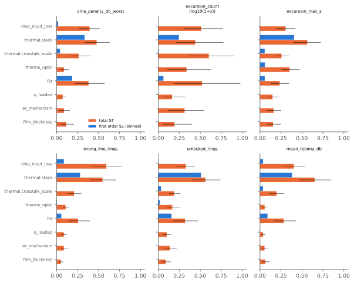

**oma_penalty_db_worst**: variance 217.3, noise variance 3.375e-09 (1.6e-09 % of it), rows dropped as non-finite 0, sum of S1 0.728 (binned: 0.528), sum of ST 1.88 (sum of the ST lower 95 % bounds 1.15)

| entry | S1 | S1 95 % | S1 binned | S1 binned 95 % | ST | ST 95 % |
|---|---|---|---|---|---|---|
| `chip_input_loss` | 0.0556 | [-0.16, 0.26] | 0.0191 | [0.0028, 0.11] | 0.394 | [0.27, 0.51] |
| `thermal.stack` | 0.174 | [-0.096, 0.46] | 0.335 | [0.21, 0.46] | 0.477 | [0.34, 0.63] |
| `thermal.crosstalk_scale` | 0.134 | [-0.017, 0.33] | 0.0414 | [0.0081, 0.14] | 0.264 | [0.16, 0.41] |
| `thermo_optic` | 0.0374 | [-0.049, 0.13] | -0.00688 | [-0.012, 0.035] | 0.0879 | [0.043, 0.15] |
| `fsr` | 0.095 | [-0.073, 0.33] | 0.186 | [0.11, 0.28] | 0.381 | [0.22, 0.57] |
| `q_loaded` | 0.0929 | [-6.7e-04, 0.2] | -0.0272 | [-0.024, 0.039] | 0.073 | [0.04, 0.11] |
| `er_mechanism` | 0.0942 | [0.0062, 0.19] | -0.0114 | [-0.012, 0.019] | 0.0883 | [0.033, 0.16] |
| `film_thickness` | 0.0445 | [-0.024, 0.13] | -0.00783 | [-0.0081, 0.015] | 0.116 | [0.051, 0.21] |

**excursion_count** (indices of log10(1+x)): variance 0.4549, noise variance 0 (0 % of it), rows dropped as non-finite 0, sum of S1 -0.308 (binned: 0.266), sum of ST 3.08 (sum of the ST lower 95 % bounds 1.39)

| entry | S1 | S1 95 % | S1 binned | S1 binned 95 % | ST | ST 95 % |
|---|---|---|---|---|---|---|
| `chip_input_loss` | -0.0948 | [-0.28, 0.17] | -0.00419 | [-0.017, 0.079] | 0.512 | [0.3, 0.77] |
| `thermal.stack` | 0.202 | [-0.018, 0.49] | 0.245 | [0.15, 0.37] | 0.441 | [0.2, 0.78] |
| `thermal.crosstalk_scale` | -0.00137 | [-0.21, 0.27] | 0.00605 | [-0.0081, 0.095] | 0.602 | [0.37, 0.9] |
| `thermo_optic` | -0.0963 | [-0.21, 0.047] | -0.00512 | [-0.011, 0.037] | 0.337 | [0.11, 0.63] |
| `fsr` | 0.0872 | [-0.11, 0.37] | 0.0616 | [0.013, 0.13] | 0.522 | [0.19, 0.98] |
| `q_loaded` | -0.0813 | [-0.18, 0.02] | -0.019 | [-0.021, 0.055] | 0.164 | [0.045, 0.32] |
| `er_mechanism` | -0.169 | [-0.28, -0.063] | -0.0105 | [-0.011, 0.022] | 0.313 | [0.12, 0.54] |
| `film_thickness` | -0.154 | [-0.28, -0.048] | -0.0078 | [-0.0088, 0.013] | 0.193 | [0.056, 0.4] |

**excursion_max_s**: variance 0.002185, noise variance 1.461e-11 (6.7e-07 % of it), rows dropped as non-finite 0, sum of S1 0.587 (binned: 0.534), sum of ST 2.18 (sum of the ST lower 95 % bounds 1.4)

| entry | S1 | S1 95 % | S1 binned | S1 binned 95 % | ST | ST 95 % |
|---|---|---|---|---|---|---|
| `chip_input_loss` | -0.019 | [-0.27, 0.23] | -0.0082 | [-0.018, 0.068] | 0.305 | [0.19, 0.42] |
| `thermal.stack` | 0.474 | [0.13, 0.8] | 0.406 | [0.31, 0.49] | 0.563 | [0.4, 0.72] |
| `thermal.crosstalk_scale` | 0.105 | [-0.078, 0.32] | 0.0558 | [0.015, 0.18] | 0.256 | [0.18, 0.35] |
| `thermo_optic` | 0.127 | [-0.11, 0.36] | 0.0589 | [0.019, 0.12] | 0.353 | [0.26, 0.47] |
| `fsr` | 0.051 | [-0.11, 0.24] | 0.0567 | [0.013, 0.13] | 0.234 | [0.13, 0.34] |
| `q_loaded` | 0.0263 | [-0.15, 0.19] | -0.0221 | [-0.023, 0.054] | 0.149 | [0.084, 0.23] |
| `er_mechanism` | -0.0501 | [-0.22, 0.11] | -0.00662 | [-0.011, 0.031] | 0.162 | [0.082, 0.25] |
| `film_thickness` | -0.127 | [-0.29, 0.022] | -0.00601 | [-0.0082, 0.019] | 0.155 | [0.081, 0.25] |

**wrong_line_rings**: variance 6.959, noise variance 0 (0 % of it), rows dropped as non-finite 0, sum of S1 0.203 (binned: 0.401), sum of ST 1.94 (sum of the ST lower 95 % bounds 1.32)

| entry | S1 | S1 95 % | S1 binned | S1 binned 95 % | ST | ST 95 % |
|---|---|---|---|---|---|---|
| `chip_input_loss` | 0.0449 | [-0.32, 0.44] | 0.0874 | [0.039, 0.19] | 0.593 | [0.43, 0.78] |
| `thermal.stack` | 0.185 | [-0.12, 0.56] | 0.281 | [0.18, 0.39] | 0.547 | [0.4, 0.71] |
| `thermal.crosstalk_scale` | 0.0505 | [-0.15, 0.24] | -0.0108 | [-0.02, 0.074] | 0.208 | [0.14, 0.3] |
| `thermo_optic` | 0.0157 | [-0.12, 0.14] | 0.00551 | [-0.0094, 0.056] | 0.108 | [0.076, 0.15] |
| `fsr` | -0.00337 | [-0.16, 0.17] | 0.0569 | [0.014, 0.12] | 0.256 | [0.14, 0.4] |
| `q_loaded` | -0.0449 | [-0.16, 0.061] | -0.00399 | [-0.018, 0.082] | 0.0864 | [0.057, 0.12] |
| `er_mechanism` | -0.0146 | [-0.18, 0.11] | -0.011 | [-0.012, 0.017] | 0.087 | [0.049, 0.13] |
| `film_thickness` | -0.0303 | [-0.097, 0.035] | -0.00375 | [-0.0076, 0.019] | 0.0516 | [0.029, 0.08] |

**unlocked_rings**: variance 8.834, noise variance 0 (0 % of it), rows dropped as non-finite 0, sum of S1 0.297 (binned: 0.676), sum of ST 1.89 (sum of the ST lower 95 % bounds 1.18)

| entry | S1 | S1 95 % | S1 binned | S1 binned 95 % | ST | ST 95 % |
|---|---|---|---|---|---|---|
| `chip_input_loss` | -0.00265 | [-0.22, 0.21] | -0.00387 | [-0.015, 0.082] | 0.328 | [0.21, 0.44] |
| `thermal.stack` | 0.444 | [0.13, 0.73] | 0.51 | [0.41, 0.61] | 0.562 | [0.4, 0.74] |
| `thermal.crosstalk_scale` | -0.0637 | [-0.22, 0.077] | 0.0333 | [0.0032, 0.15] | 0.19 | [0.13, 0.27] |
| `thermo_optic` | -0.0106 | [-0.18, 0.12] | 0.0182 | [-0.0055, 0.072] | 0.167 | [0.094, 0.26] |
| `fsr` | 0.111 | [-0.088, 0.32] | 0.158 | [0.087, 0.28] | 0.318 | [0.18, 0.47] |
| `q_loaded` | 0 | [-0.13, 0.1] | -0.0214 | [-0.021, 0.056] | 0.1 | [0.06, 0.15] |
| `er_mechanism` | -0.143 | [-0.34, -0.011] | -0.0106 | [-0.012, 0.017] | 0.138 | [0.068, 0.22] |
| `film_thickness` | -0.038 | [-0.12, 0.035] | -0.00749 | [-0.0079, 0.011] | 0.0884 | [0.038, 0.15] |

**mean_reloma_db**: variance 86.24, noise variance 2.094e-09 (2.4e-09 % of it), rows dropped as non-finite 0, sum of S1 0.376 (binned: 0.499), sum of ST 1.74 (sum of the ST lower 95 % bounds 1.12)

| entry | S1 | S1 95 % | S1 binned | S1 binned 95 % | ST | ST 95 % |
|---|---|---|---|---|---|---|
| `chip_input_loss` | -0.0337 | [-0.35, 0.27] | 0.0367 | [0.016, 0.13] | 0.403 | [0.29, 0.54] |
| `thermal.stack` | 0.283 | [-0.11, 0.79] | 0.382 | [0.27, 0.5] | 0.651 | [0.47, 0.85] |
| `thermal.crosstalk_scale` | 0.054 | [-0.12, 0.24] | 0.0347 | [0.0041, 0.14] | 0.197 | [0.12, 0.29] |
| `thermo_optic` | 0.0231 | [-0.11, 0.15] | -0.00721 | [-0.012, 0.033] | 0.0552 | [0.028, 0.087] |
| `fsr` | -0.0292 | [-0.22, 0.21] | 0.0898 | [0.031, 0.18] | 0.284 | [0.16, 0.43] |
| `q_loaded` | 0.0539 | [-0.011, 0.15] | -0.0187 | [-0.021, 0.054] | 0.0364 | [0.017, 0.063] |
| `er_mechanism` | 0.0045 | [-0.091, 0.098] | -0.0117 | [-0.012, 0.017] | 0.0535 | [0.022, 0.091] |
| `film_thickness` | 0.0203 | [-0.045, 0.095] | -0.00697 | [-0.008, 0.012] | 0.0636 | [0.025, 0.11] |

Reading: ST - S1 is the share of variance through interactions; a sum of ST above 1 (judge it by the sum of the lower bounds) means the metric responds to combinations of entries, typically a threshold such as a lock loss or a supply limit. The Saltelli S1 (from the A, B and AB_i rows) is poorly resolved with 128 base rows for these threshold-like metrics (a negative S1 or an interval that spans 0 is estimator noise, not a negative effect). 'S1 binned' re-estimates S1 from the 2 x 128 independent A and B rows by binning each entry (a hypothesis by its choices, an interval in 8 equal-probability bins, bias of the bin means removed; `sensitivity.given_data_first_order`): better resolved, slightly low for a smooth interval effect. All indices are conditional on the other 17 free entries at nominal.

## 5. Controller rank stability across worlds

Performance is conditional on the assumed thermal dynamics (heater, crosstalk and aggressor poles) until Q1 (the heater step response at the lock point, 07 section 5) is answered.

Source: `mrm.sim.experiment` kind compare ({"experiment": "experiments/examples/compare_locks.yaml re-based on the preset", "experiment_hash": "b0d71dd2e16ed568", "n_mc": 256}); wall 2013 s. For each rank metric (lower is better), Kendall's tau-b between every world's ranking (Latin-hypercube worlds and named corners) and the nominal ranking; 'defined' is the fraction of worlds where tau exists (a ranking of all ties has none).

| metric | nominal order (best first) | median order | tau mean | tau median | tau min | same order | defined |
|---|---|---|---|---|---|---|---|
| oma_penalty_db_worst | mpc_c < kalman_lqg_c < pi_lock_c < pi_lock_c_type2 | pi_lock_c < pi_lock_c_type2 < mpc_c < kalman_lqg_c | -0.103 | 0 | -1 | 0.0595 | 1 |
| excursion_count | pi_lock_c_type2 < pi_lock_c < mpc_c < kalman_lqg_c | pi_lock_c < pi_lock_c_type2 < mpc_c < kalman_lqg_c | 0.296 | 0.548 | -1 | 0.0553 | 0.941 |
| excursion_max_s | pi_lock_c_type2 < pi_lock_c < kalman_lqg_c < mpc_c | pi_lock_c_type2 < pi_lock_c < mpc_c < kalman_lqg_c | 0.356 | 0.667 | -1 | 0.204 | 1 |
| wrong_line_rings | pi_lock_c < pi_lock_c_type2 < kalman_lqg_c < mpc_c | pi_lock_c < pi_lock_c_type2 < mpc_c < kalman_lqg_c | nan | nan | nan | nan | 0 |
| time_to_lock_s | pi_lock_c_type2 < pi_lock_c < mpc_c < kalman_lqg_c | pi_lock_c < pi_lock_c_type2 < kalman_lqg_c < mpc_c | 0.704 | 0.816 | -0.548 | 0.135 | 0.357 |

| controller | nominal | worst named corner | oma_penalty_db_worst median [p5, p95] | excursion_count median [p5, p95] | excursion_max_s median [p5, p95] | wrong_line_rings median [p5, p95] | time_to_lock_s median [p5, p95] | supply-limited worlds |
|---|---|---|---|---|---|---|---|---|
| pi_lock_c | oma_penalty_db_worst 0.3159, excursion_count 4, excursion_max_s 0.01379, wrong_line_rings 0, time_to_lock_s 0.06765 | g26_hot_selfheat: wrong-line rings 8, unlocked rings 0, worst-lane OMA penalty 19.768 dB, excursions 2 | 5.762 [0.1448, 39.34] | 5 [2, 434] | 0.08119 [0.001814, 0.129] | 2 [0, 8] | inf [0.062, inf] | 0.32 |
| pi_lock_c_type2 | oma_penalty_db_worst 0.3159, excursion_count 3, excursion_max_s 0.01374, wrong_line_rings 0, time_to_lock_s 0.06699 | g26_hot_selfheat: wrong-line rings 8, unlocked rings 0, worst-lane OMA penalty 19.768 dB, excursions 2 | 6.108 [0.1449, 38.96] | 4 [1, 522] | 0.07784 [0.001332, 0.1293] | 2 [0, 7] | inf [0.06173, inf] | 0.32 |
| kalman_lqg_c | oma_penalty_db_worst 0.2098, excursion_count 6, excursion_max_s 0.01526, wrong_line_rings 0, time_to_lock_s 0.06967 | g26_hot_selfheat: wrong-line rings 7, unlocked rings 8, worst-lane OMA penalty 20.091 dB, excursions 27 | 27.02 [0.4189, 36.5] | 9 [2, 41] | 0.09762 [0.004768, 0.1293] | 6 [0, 8] | inf [0.06562, inf] | 0.32 |
| mpc_c | oma_penalty_db_worst 0.2095, excursion_count 5, excursion_max_s 0.01528, wrong_line_rings 0, time_to_lock_s 0.06926 | g26_hot_selfheat: wrong-line rings 6, unlocked rings 8, worst-lane OMA penalty 20.101 dB, excursions 25 | 26.61 [0.4189, 35.61] | 8 [2, 23] | 0.09573 [0.004444, 0.1297] | 5 [0, 8] | inf [0.06529, inf] | 0.32 |

A ranking claim holds only if it holds over the set (07 4.8). The worlds mix controller robustness with warm-start failures (supply-limited worlds start with rings the bank cannot hold; experiments handoff 9.7 and 12).

## 6. Generation mix of the derived quantities

Preset `g26`: G26 (LM26-P, LM26-S, QDSOA): channel plan, laser power at the module, 8 rings per bus, drop-port monitor topology, 16-bit heater DAC, bias axis 1.0-3.75 V, 50 Gb/s NRZ, 2 s BER interval, the ~15 GHz/degC aside (H86). G25 (LM-P, LM-T via the textbook): Q_L, notch depths, blue offset 7.6 nm, heater P_FSR/R/V, droop fit, junction efficiency ladder, responsivity, +4 dBm at the ring, 1.3 Vpp driver. GF 45SPCLO (GF-IMAPS, GF-BIAN, GF-ECIO): 160 nm film, 2 um BOX, passive loss, Ge PD dark current. Literature (imec CO22/CO24): thermal poles and crosstalk. Solver (mrm/data/extracted, assumed geometry): bent-mode indices, dlambda/dT(T), Jacobian, bend radiation, coupler dispersion. PAT-2: integrating ADC and DAC+PWM heater drive. Everything else is assumed and says so.

Each derived quantity (relations of 07 P0-3 and the diagnostics of `derive()`) with the generation of every config leaf it rests on (recursively) and its weakest input provenance (07 P1-14).

| quantity | generations (leaves) | weakest provenance |
|---|---|---|
| `derived.optics.alpha_heat_per_m` | **none**: optics.loss_budget.alpha_fca_db_per_cm, optics.loss_budget.alpha_other_abs_db_per_cm | assumed |
| `derived.optics.alpha_i_per_m` | **none**: optics.loss_budget.alpha_bend_radiation_db_per_cm, optics.loss_budget.alpha_fca_db_per_cm, optics.loss_budget.alpha_other_abs_db_per_cm, optics.loss_budget.alpha_scatter_db_per_cm, optics.n_g | assumed |
| `derived.optics.alpha_l_slope_eff_per_k2` | **none**: optics.alpha_l_slope_per_k2 | literature |
| `derived.optics.alpha_nonheat_per_m` | **none**: optics.loss_budget.alpha_bend_radiation_db_per_cm, optics.loss_budget.alpha_scatter_db_per_cm | assumed |
| `derived.optics.d2n_eff_dt2_per_k2` | **none**: optics.alpha_l_slope_per_k2, optics.n_g, thermal.dlambda_dt_beta_per_k, thermal.dlambda_dt_pm_per_k | solver(assumed-geometry) |
| `derived.optics.fsr_hz` | **G25**: optics.fsr_thz | printed |
| `derived.optics.fsr_m` | **G25**: optics.fsr_thz | printed |
| `derived.optics.kappa2_drop` | **G25**: optics.fsr_thz, optics.q_loaded; **G26**: optics.kappa_d_over_kappa; **none**: optics.n_g | solver(assumed-geometry) |
| `derived.optics.kappa2_through` | **G25**: optics.fsr_thz, optics.q_loaded; **G26**: optics.kappa_d_over_kappa; **none**: optics.loss_budget.alpha_bend_radiation_db_per_cm, optics.loss_budget.alpha_fca_db_per_cm, optics.loss_budget.alpha_other_abs_db_per_cm, optics.loss_budget.alpha_scatter_db_per_cm, optics.n_g | assumed |
| `derived.optics.length_m` | **G25**: optics.fsr_thz; **none**: optics.n_g | solver(assumed-geometry) |
| `derived.optics.lock_offset_m` | **G25**: optics.fsr_thz, optics.resonance_offset_nm | inferred |
| `derived.optics.n_eff_correction` | **none**: optics.n_eff | solver(assumed-geometry) |
| `derived.optics.n_eff_phase` | **G25**: optics.fsr_thz, optics.resonance_offset_nm; **none**: optics.n_eff, optics.n_g | solver(assumed-geometry) |
| `derived.optics.round_trip_amplitude` | **G25**: optics.fsr_thz; **none**: optics.loss_budget.alpha_bend_radiation_db_per_cm, optics.loss_budget.alpha_fca_db_per_cm, optics.loss_budget.alpha_other_abs_db_per_cm, optics.loss_budget.alpha_scatter_db_per_cm, optics.n_g | assumed |
| `derived.optics.round_trip_time_s` | **G25**: optics.fsr_thz | printed |
| `derived.thermal.beta_eff_per_k` | **none**: thermal.dlambda_dt_beta_per_k | solver(assumed-geometry) |
| `derived.thermal.dt_fsr_k` | **G25**: heater.p_fsr_ref_temp_c, optics.fsr_thz; **none**: thermal.dlambda_dt_beta_per_k, thermal.dlambda_dt_pm_per_k | solver(assumed-geometry) |
| `derived.thermal.s_lock_m_per_k` | **G25**: optics.fsr_thz, optics.resonance_offset_nm, optics.resonance_offset_ref_temp_c; **none**: thermal.dlambda_dt_beta_per_k, thermal.dlambda_dt_pm_per_k, thermal.dlambda_dt_ref_ring_temp_c | solver(assumed-geometry) |
| `ring.geometry.radius_um` | **G25**: optics.fsr_thz; **none**: optics.n_g | solver(assumed-geometry) |
| `ring.heater.efficiency_nm_per_mw` | **G25**: heater.p_fsr_mw, optics.fsr_thz | printed |
| `ring.optics.dn_eff_dt_per_k` | **none**: optics.alpha_l_per_k, optics.n_eff, optics.n_g, thermal.dlambda_dt_pm_per_k | solver(assumed-geometry) |
| `ring.optics.heat_fraction` | **none**: optics.loss_budget.alpha_bend_radiation_db_per_cm, optics.loss_budget.alpha_fca_db_per_cm, optics.loss_budget.alpha_other_abs_db_per_cm, optics.loss_budget.alpha_scatter_db_per_cm | assumed |
| `ring.optics.order` | **G25**: optics.fsr_thz, optics.resonance_offset_nm; **none**: optics.n_eff, optics.n_g | solver(assumed-geometry) |
| `ring.optics.q_drop` | **G25**: optics.q_loaded; **G26**: optics.kappa_d_over_kappa | inferred |
| `ring.optics.q_intrinsic` | **none**: optics.loss_budget.alpha_bend_radiation_db_per_cm, optics.loss_budget.alpha_fca_db_per_cm, optics.loss_budget.alpha_other_abs_db_per_cm, optics.loss_budget.alpha_scatter_db_per_cm, optics.n_g | assumed |
| `ring.optics.q_through` | **G25**: optics.q_loaded; **G26**: optics.kappa_d_over_kappa; **none**: optics.loss_budget.alpha_bend_radiation_db_per_cm, optics.loss_budget.alpha_fca_db_per_cm, optics.loss_budget.alpha_other_abs_db_per_cm, optics.loss_budget.alpha_scatter_db_per_cm, optics.n_g | assumed |
| `ring.thermal.t_ring_lock_c` | **G25**: optics.fsr_thz, optics.resonance_offset_nm, optics.resonance_offset_ref_temp_c; **none**: thermal.dlambda_dt_beta_per_k, thermal.dlambda_dt_pm_per_k, thermal.dlambda_dt_ref_ring_temp_c | assumed |
| `ring.thermal.z_heater_ring_k_per_mw` | **G25**: heater.p_fsr_mw, heater.p_fsr_ref_temp_c, optics.fsr_thz; **none**: thermal.dlambda_dt_beta_per_k, thermal.dlambda_dt_pm_per_k | solver(assumed-geometry) |
| diagnostic `implied_index_weight` | **none**: optics.alpha_l_per_k, optics.index_weight_oxide, optics.n_eff, optics.n_g, thermal.dlambda_dt_pm_per_k, thermal.dlambda_dt_ref_ring_temp_c | solver(assumed-geometry) |
| diagnostic `index_weight_ceiling` | **none**: optics.n_g | solver(assumed-geometry) |
| diagnostic `index_weight_ratio` | **none**: optics.alpha_l_per_k, optics.index_weight_oxide, optics.n_eff, optics.n_g, thermal.dlambda_dt_pm_per_k, thermal.dlambda_dt_ref_ring_temp_c | solver(assumed-geometry) |
| diagnostic `p_in_ring_dbm` | **G25**: optical_path.chip_input_loss_db; **G26**: laser.power_per_line_dbm; **GF**: optical_path.bus_loss_db_per_mm | inferred |
| diagnostic `p_abs_peak_mw` | **G25**: optical_path.chip_input_loss_db, optics.q_loaded; **G26**: laser.power_per_line_dbm, optics.kappa_d_over_kappa; **GF**: optical_path.bus_loss_db_per_mm; **none**: optics.loss_budget.alpha_bend_radiation_db_per_cm, optics.loss_budget.alpha_fca_db_per_cm, optics.loss_budget.alpha_other_abs_db_per_cm, optics.loss_budget.alpha_scatter_db_per_cm, optics.n_g | assumed |
| diagnostic `self_heating_gain_pm_per_mw` | **G25**: heater.p_fsr_mw, optics.fsr_thz, optics.resonance_offset_nm, optics.resonance_offset_ref_temp_c; **none**: thermal.dlambda_dt_beta_per_k, thermal.dlambda_dt_pm_per_k, thermal.dlambda_dt_ref_ring_temp_c, thermal.z_ratio_opt_heater | solver(assumed-geometry) |
| diagnostic `bistability_ratio` | **G25**: heater.p_fsr_mw, optical_path.chip_input_loss_db, optics.fsr_thz, optics.q_loaded, optics.resonance_offset_nm, optics.resonance_offset_ref_temp_c; **G26**: laser.power_per_line_dbm, optics.kappa_d_over_kappa; **GF**: optical_path.bus_loss_db_per_mm; **none**: optics.loss_budget.alpha_bend_radiation_db_per_cm, optics.loss_budget.alpha_fca_db_per_cm, optics.loss_budget.alpha_other_abs_db_per_cm, optics.loss_budget.alpha_scatter_db_per_cm, optics.n_g, thermal.dlambda_dt_beta_per_k, thermal.dlambda_dt_pm_per_k, thermal.dlambda_dt_ref_ring_temp_c, thermal.z_ratio_opt_heater | solver(assumed-geometry) |
| diagnostic `t_ring_lock_c` | **G25**: optics.fsr_thz, optics.resonance_offset_nm, optics.resonance_offset_ref_temp_c; **none**: thermal.dlambda_dt_beta_per_k, thermal.dlambda_dt_pm_per_k, thermal.dlambda_dt_ref_ring_temp_c | assumed |
| diagnostic `t_amb_order_hop_c` | **G25**: heater.p_fsr_mw, optical_path.chip_input_loss_db, optics.fsr_thz, optics.q_loaded, optics.resonance_offset_nm, optics.resonance_offset_ref_temp_c; **G26**: laser.power_per_line_dbm, optics.kappa_d_over_kappa; **GF**: optical_path.bus_loss_db_per_mm; **none**: optics.loss_budget.alpha_bend_radiation_db_per_cm, optics.loss_budget.alpha_fca_db_per_cm, optics.loss_budget.alpha_other_abs_db_per_cm, optics.loss_budget.alpha_scatter_db_per_cm, optics.n_g, thermal.dlambda_dt_beta_per_k, thermal.dlambda_dt_pm_per_k, thermal.dlambda_dt_ref_ring_temp_c, thermal.z_ratio_opt_heater | assumed |
| diagnostic `next_order_distance_ghz` | **G25**: optics.fsr_thz, optics.resonance_offset_nm; **G26**: channel_plan.spacing_ghz; **none**: optics.dn_g_dlambda_per_nm, optics.n_g | solver(assumed-geometry) |
| diagnostic `next_order_distance_fwhm` | **G25**: optics.fsr_thz, optics.q_loaded, optics.resonance_offset_nm; **G26**: channel_plan.spacing_ghz, optics.kappa_d_over_kappa; **none**: optics.dln_kappa2_drop_dlambda_per_nm, optics.dln_kappa2_through_dlambda_per_nm, optics.dn_g_dlambda_per_nm, optics.n_g | solver(assumed-geometry) |
| diagnostic `monitor_codes_per_uw_at_drop` | **G25**: monitor.responsivity_a_per_w; **G26**: monitor.adc_bits; **none**: monitor.adc_full_scale_ua, monitor.gain_scale | assumed |
| diagnostic `heater_pm_per_code` | **G25**: heater.p_fsr_mw, heater.r_cold_ohm, optics.fsr_thz; **G26**: heater.dac_bits; **none**: heater.full_scale_a, heater.full_scale_v, heater.full_scale_w | assumed |
| diagnostic `fwhm_pm` | **G25**: optics.q_loaded, optics.resonance_offset_nm | inferred |
| diagnostic `disturbance_pm_per_k` | **G25**: optics.fsr_thz, optics.resonance_offset_nm, optics.resonance_offset_ref_temp_c; **none**: thermal.dlambda_dt_beta_per_k, thermal.dlambda_dt_pm_per_k, thermal.dlambda_dt_ref_ring_temp_c | solver(assumed-geometry) |
| diagnostic `selfheat_pm_per_mw_in` | **G25**: heater.p_fsr_mw, optics.fsr_thz, optics.q_loaded, optics.resonance_offset_nm, optics.resonance_offset_ref_temp_c; **G26**: optics.kappa_d_over_kappa; **none**: optics.loss_budget.alpha_bend_radiation_db_per_cm, optics.loss_budget.alpha_fca_db_per_cm, optics.loss_budget.alpha_other_abs_db_per_cm, optics.loss_budget.alpha_scatter_db_per_cm, optics.n_g, thermal.dlambda_dt_beta_per_k, thermal.dlambda_dt_pm_per_k, thermal.dlambda_dt_ref_ring_temp_c, thermal.z_ratio_opt_heater | solver(assumed-geometry) |
| diagnostic `heater_efficiency_nm_per_mw` | **G25**: heater.p_fsr_mw, optics.fsr_thz | printed |
| diagnostic `z_heater_ring_k_per_mw` | **G25**: heater.p_fsr_mw, heater.p_fsr_ref_temp_c, optics.fsr_thz; **none**: thermal.dlambda_dt_beta_per_k, thermal.dlambda_dt_pm_per_k | solver(assumed-geometry) |
| diagnostic `fsr_thz` | **G25**: optics.fsr_thz | printed |
| diagnostic `fsr_nm` | **G25**: optics.fsr_thz | printed |
| diagnostic `radius_um` | **G25**: optics.fsr_thz; **none**: optics.n_g | solver(assumed-geometry) |

Leaves by generation and provenance:

| generation | assumed | inferred | literature | printed | solver(assumed-geometry) | total |
|---|---|---|---|---|---|---|
| G25 | 3 | 6 | 0 | 7 | 0 | 16 |
| G26 | 2 | 5 | 0 | 8 | 0 | 15 |
| GF | 1 | 1 | 0 | 3 | 0 | 5 |
| Guide | 0 | 0 | 0 | 1 | 0 | 1 |
| PAT | 1 | 2 | 0 | 2 | 0 | 5 |
| none | 59 | 8 | 15 | 0 | 10 | 92 |

## 7. Disagreements with the textbook

Generated from the `textbook:` and `disagrees:` fields of preset `g26` (07 P1-14). Where the leaf carries a `textbook` alternative, its value is shown (select it with `--alt <path>=textbook`).

| key | value here | textbook field | textbook alternative | disagreement |
|---|---|---|---|---|
| `channel_plan.center_thz` | 228.749 | REF.lambdaNm |  |  |
| `channel_plan.n_lines` | 8 | REF.nChannels |  |  |
| `channel_plan.spacing_ghz` | 400 | REF.perDirectionGridGHz |  |  |
| `driver.swing_pp_v` | 1.3 | REF.swingVpp |  | the textbook's 0.9 Vpp 'measured' is the pattern-generator swing into the 50-ohm-terminated driver, not the junction swing (01 D3) |
| `laser.line_offset_ghz` | 0 | REF.laserAccuracyGhz |  |  |
| `laser.linewidth_mhz` | 1 | REF.laserLinewidthMhz |  |  |
| `laser.power_per_line_dbm` | 10 | REF.laserPerLambdaDbmM1000 |  | the textbook's 14 dBm per line for M1000 was not found in any public source (01 D16); the G26 hardware budget prints 10 dBm/line into the TX, and 100 mW/fibre over 16 lines is 8 dBm |
| `optical_path.chip_input_loss_db` | 6 | REF.inputPowerDbm |  |  |
| `ring.bias_dac.v_min_v` | 1 | REF.biasRangeV |  |  |
| `ring.geometry.film_nm` | 160 | REF.waveguideLmNm |  | the textbook uses the 400 x 200 nm SMTAI render; GF 45SPCLO prints a 160 nm photonics film and G25 is printed as 45SPCLO (01 D1, 07 D21); 200 nm stays a hypothesis |
| `ring.geometry.radius_um` | (derived) | REF.radiusUm |  |  |
| `ring.heater.code_min` | 0 | REF.heaterDacCodeRange |  | the textbook's 19,500-49,300 is the range one test used, i.e. demand, not hardware (07 P1-11) |
| `ring.heater.dac_bits` | 16 | REF.heaterDacBits |  |  |
| `ring.heater.p_fsr_mw` | 25.45 | REF.heaterPFsrMw |  |  |
| `ring.heater.r_cold_ohm` | 45.41 | REF.heaterOhm |  |  |
| `ring.heater.tcr_per_k` | 0.0014 | REF.heaterTcrPerK | 0.001 | the textbook's 1e-3 /K is assumed (only y = TCR R_th,H is fitted to the droop); doped Si is 1.0-1.8e-3 /K (02 section 9) and 07 P1-11 ties the TCR to the heater family |
| `ring.junction.eff_at_0v_pm_per_v` | 72.5 | REF.modEffPmPerV |  | the textbook's flat 50 pm/V (talk) matches only near 1 V; a depletion law falls from 72.5 pm/V at 0 V to 32 pm/V at 3.75 V and reproduces the 52.8 pm/V average over 0-1.6 V (03 section 5.3, 06 M2) |
| `ring.monitor.adc_bits` | 16 | REF.monitorAdcBits |  |  |
| `ring.monitor.input_noise_pa_per_rt_hz` | 1 | REF.afeNoisePaRtHz |  | the textbook applies the data-path AFE's 6.4 pA/rtHz (16 GHz RX TIA) to the monitor; a ~100 kOhm monitor TIA has ~0.4 pA/rtHz (06 S3) |
| `ring.monitor.responsivity_a_per_w` | 0.95 | REF.responsivityTypical |  |  |
| `ring.optics.dln_kappa2_through_dlambda_per_nm` | 0.00766998 | REF.erVsHeaterV |  | the textbook interpolates the notch depth against heater voltage; under lock the heater moves while the resonance stays at the line, so the extinction is modelled from the coupler dispersion at each line and loss against temperature (06 O5, 07 P1-5) |
| `ring.optics.fsr_thz` | 1.8 | REF.fsrTHz |  | the textbook's measured bound FSR >= 14.1 nm is unsupported: the G25 traces are ~1 nm windows (01 D2, 07 D17) |
| `ring.optics.index_weight_oxide` | 0.25 | REF.confinement |  | the textbook weights Si and oxide by 0.85 and 0.15 (summing to 1); 0.85 is the Poynting power fraction, while the exact index weights are 1.04-1.09 for Si and 0.12-0.23 for the oxide (06 T2) |
| `ring.optics.loss_budget.alpha_fca_db_per_cm` | 80 | Ch17 eq. 17.7 eta_abs (0.3, assumed) |  | the textbook assumes an absorbed fraction of 0.3 (Ch10, Ch17 eq. 17.7); 07 D1/P0-2 derive eta ~0.85 from this budget |
| `ring.optics.n_eff` | 2.43993 | REF.neff |  |  |
| `ring.optics.n_g` | 3.94049 | REF.ng |  | 4.2 is assumed in the textbook and leans high for a 160 nm film (01 REF check: BU 45CLO rib 3.91-3.98, 400 x 160 strip 4.04-4.07) |
| `ring.optics.q_loaded` | 3850 | REF.Q |  | the textbook uses the printed 3500 (talk) and lists the linewidth read-off 3900-4200 separately; we take the CAL-1 interval 3500-4200 with its midpoint as nominal (07 4.3, 4.8) |
| `ring.optics.resonance_offset_nm` | 7.6 | REF.blueBiasMeasuredNm |  |  |
| `ring.thermal.dlambda_dt_beta_per_k` | 0.00147227 | REF.dnSi_dT |  | the textbook holds dn_Si/dT at the C-band 300 K value 1.86e-4 /K; at 1310 nm it is 1.94e-4 /K at 300 K and rises ~14 % per 100 K (06 T6, 02 headline 1) |
| `ring.thermal.dlambda_dt_pm_per_k` | 65.0751 | REF.dLambdaDT_pmK |  | the textbook's design value is the printed ~15 GHz/degC = 86 pm/K, an aside in the G26 introduction above the materials ceiling (71 pm/K at 300 K); 07 D2 makes the solver value the default and 86 the H86 hypothesis. Its derived 50 pm/K used the power fraction instead of the index weight (06 T3) |
| `ring.thermal.heater_self_ratio` | 1.158 | REF.heaterSelfHeatPerMw | 1.621 |  |
| `ring.thermal.share_fast_frac` | 0.4057 | REF.slowShare | 0.75 |  |
| `ring.thermal.tau_fast_s` | 3.18e-06 | REF.tauThUs | 1e-05 | the textbook assumes 10 us + 300 us (25 %) with no source; the only measured-calibrated multi-pole set is imec's 3.2 us (43 %) + 13.0 us (57 %) (07 D22). Its 63 % point is 7.3 us (04 V5), close to the textbook's 10 us |
| `ring.thermal.tau_slow_s` | 1.301e-05 | REF.tauSlowUs | 0.0003 |  |
| `ring.thermal.xt_nearest_frac` | 0.03 | REF.crosstalkNearest | 0.1 | the textbook assumes 10 % to the nearest and 3 % to the next ring with the self-path dynamics; imec measures 1.3-2.6 % out to 300 um arriving with 4-9 ms poles (07 D22, 04 X1-X2); 10 % stays as the pessimistic corner |
| `ring.thermal.xt_next_frac` | 0.015 | REF.crosstalkNext | 0.03 |  |
| `ring.thermal.z_heater_ring_k_per_mw` | (derived) | REF.RthKPerMw |  |  |
| `ring.thermal.z_ratio_opt_heater` | 1.76 | Ch17 eq. 17.9a (one K for heater and absorbed power) |  | the textbook heats the ring with the heater's R_th for absorbed light too (ratio 1, Ch17 eq. 17.9a); by reciprocity Z_opt >= Z_heater for a heater outside the mode (06 H2) |

38 leaves disagree with the textbook.

## Contamination warnings

Copied from `mrm/validation/targets/README.md`: research-report fits that used held-out data; their results must not become defaults or priors.

Some research-report fits used held-out data. Their results must not become preset defaults or priors:

- 03 key finding 5 fitted the coupling-dispersion slope s = 1.48 %/nm to all 8 notch depths, including the held-out
  1.4 and 1.5 V points (VAL-2). Use the femwell solver slope (1.3 to 1.5 %/nm, 05 t02) or refit on CAL-2 only.
- 06 section 4.3 and V5 matched Q and dlambda/dT to the loop-open contours, including the -16 dB contour of VAL-5.
  Its "Q 3600 to 4400 at 86 pm/K" must not be used as a Q prior.
- 06 M6 inverted the swing from both the -2.1 and the -3.0 dB levels (169 to 227 pm at Q 3500). The -3.0 dB contour
  is VAL-4; the swing prior must come from CAL-14 (-2.1 dB) alone.
- The interim thermal model takes its poles from the imec family (07 P1-2). Comparing the interim model, rather than
  the FEM pipeline, with VAL-8 is tautological.
