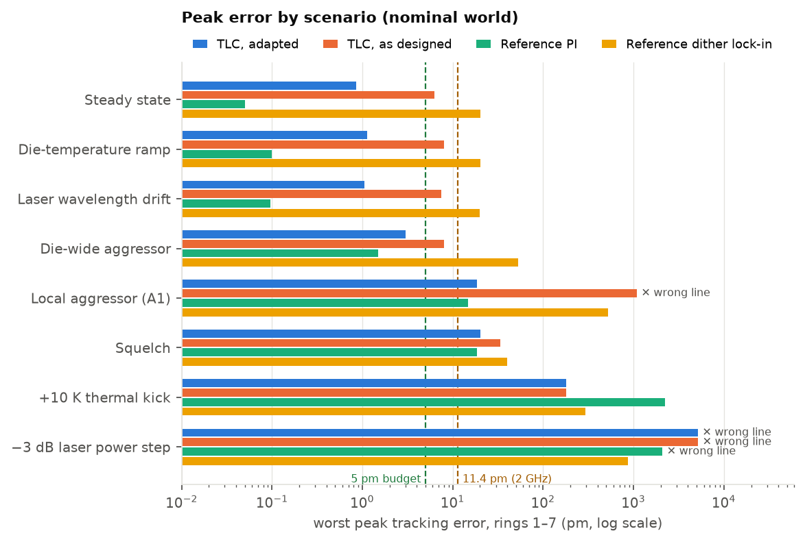
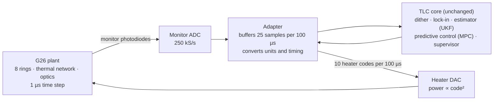
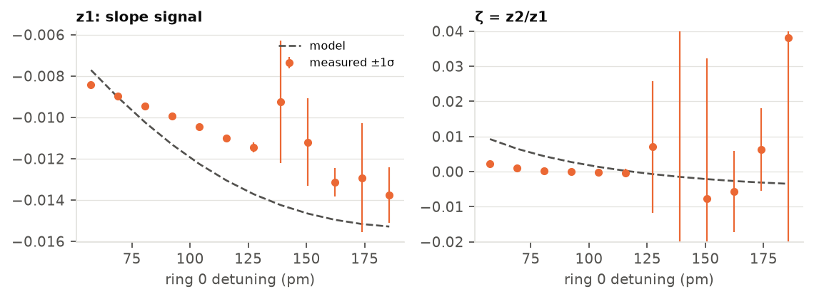
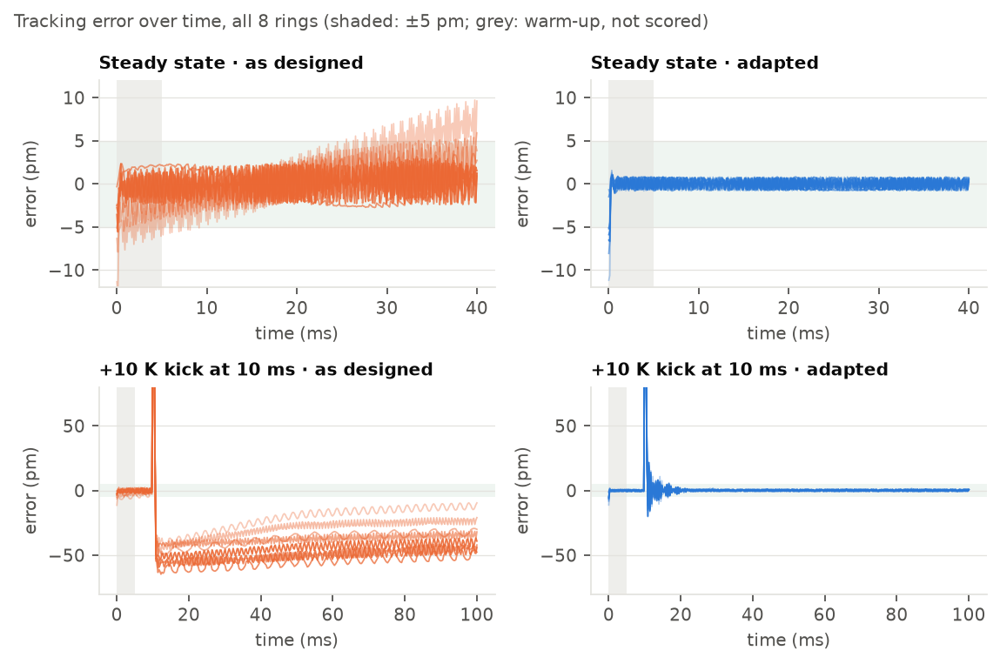
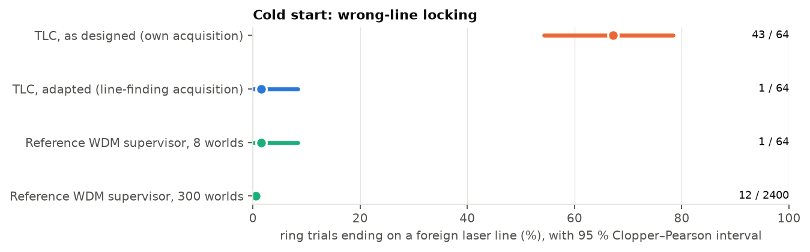

# Thermal Locking Controller on the G26 Transmitter Model

**Evaluation report** · ECE496 capstone · 26 November 2026

| | |
|---|---|
| Controller | ECE496 thermal locking controller (TLC), source revision `ae9556b` (20 Nov 2026) |
| Test plant | mrm-model, G26 preset: 8-ring O-band microring transmitter, 1310 nm |
| Evidence | 151 closed-loop simulation runs; full tables in `docs/tlc/results.md` |
| Status | Draft for review |

---

## Executive summary

We evaluated the thermal locking controller (TLC) designed in this capstone on an independent, higher-fidelity
simulation of an 8-ring microring transmitter (the G26 model in mrm-model), and compared it with four reference
controllers that ship with that simulator.

1. **The port is verified.** The controller code under test is bit-for-bit identical to the team's design and
   reproduces the design's published results on its original 4-ring plant. Every result below therefore describes
   the design itself, not a porting error.
2. **As designed, the TLC holds lock in slow disturbances but not in fast or large ones.** It tracks steady state,
   die-temperature ramps, laser drift and a die-wide aggressor at 1.8–2.6 pm rms (6–8 pm peak): inside the project's
   2 GHz (11.4 pm) threshold, outside the simulator's 5 pm budget. It loses lock under the on-die local aggressor and a
   +10 K thermal kick, and at cold start it locks most rings onto a neighbouring laser line (43 of 64 ring trials).
3. **We traced each failure to a cause** in how the design interacts with this plant: a wider resonance, strong
   optical self-heating, a dense 8-line laser grid and an averaged monitor signal. Four causes were addressable.
4. **With four disclosed adaptations, the TLC meets the 5 pm budget** in every slow scenario on every ring (0.86–3.0
   pm peak, about 0.55 pm rms), holds the local aggressor as well as the reference controllers, recovers from the
   thermal kick, and reduces cold-start wrong-line locks to 1 in 64.
5. **The adapted TLC outperforms the comparable reference controller** (a dither lock-in loop) in every scenario,
   by 18–28× in steady state, drift and aggressors. It stays behind the model-based reference controllers in quiet
   steady state (0.86 vs 0.03–0.05 pm), because a dithering controller always carries its own small probe signal.
6. **One scenario defeats every controller**, ours included: a 3 dB drop in laser power at the rings, which knocks
   the resonances off their self-heated operating branch by about 0.9 nm within 0.1 ms.



*Figure 1. Worst peak error on rings 1–7 for each scenario, log scale (values in Table 3). ✕: a ring finished
locked to the wrong laser line.*

---

## 1. Background and objective

A microring modulator only works when its resonance sits at a fixed offset from its laser line. The resonance
moves by tens of picometres per kelvin, so die heating, neighbouring circuits and laser drift continually push it
off; each ring has a heater, and a thermal locking controller adjusts the heaters to hold every ring at its operating
point.

The TLC was designed and validated on a purpose-built 4-ring plant written by the team. The question for this phase
is whether the design holds on a plant it was not designed against. The G26 model in mrm-model provides that plant:
an independent physics model of an 8-ring transmitter with its own thermal network, optics, monitor photodiodes,
ADC and heater DAC.

**Objectives**

- Run the TLC closed loop on the G26 model, unchanged, under the same disturbances its requirements define (R1–R22).
- Measure it against the simulator's own controllers on identical conditions.
- Explain every failure, and determine what it would take for the design to succeed on this plant.

**How results are reported.** Every scenario is reported for the controller **as designed** and, separately, for
the controller with **disclosed adaptations** (section 5). The adapted results never replace the as-designed ones.

---

## 2. System under test



*Figure 2. Closed loop. Only the adapter is new code; the controller core is copied from the design repository.*

**How the TLC works.** Each heater carries a small sinusoidal tone (the dither). Demodulating the monitor photodiode
at the tone gives the slope of the ring's resonance (z1); at twice the tone it gives the curvature (z2). Their ratio
ζ = z2/z1 does not depend on optical power, so an unscented Kalman filter (UKF) uses it, with the photodiode's DC
level, to estimate each ring's detuning, drift rate and an optical power scale. A model-predictive controller (MPC)
sets the heaters; a supervisor manages start-up, tracking, loss of lock, squelch and a fallback PI loop.

**What changes between the two plants**

| | Design plant (4 rings) | G26 model (8 rings) |
|---|---|---|
| Resonance half-width | ~20 GHz | ~32 GHz (broadened by the 53 Gb/s modulation) |
| Heater response | 13 µs and 78 µs poles | 3.2 µs, 13 µs and a 4 ms package tail |
| Thermal crosstalk | 20 / 6 / 2 % to the three nearest rings | 3 % to the neighbour, 1.5 % to every other ring |
| Monitor | 12-bit, 1 MS/s, sees data-pattern noise | 16-bit, 250 kS/s, averaged over the data pattern |
| Local aggressor | ~200 pm/ms, 3 K swing | ~170 pm/ms, 88.5 K swing |
| Controller interface | 100 µs blocks of 100 samples | called every 10 µs with 2–3 samples |

---

## 3. Methodology

### 3.1 Faithful port and verification

The controller was copied, not rewritten. The only changes are packaging and making the ring count a parameter
instead of a fixed 4. Two automated checks guard the port:

- **Bit-identity.** On the design's own 4-ring plant, the copied controller must produce exactly the same outputs as
  the original, signal by signal, for both the sine and the triangle dither. It does.
- **Published results.** It must reproduce the design's published steady-state (R1), aggressor (R3) and recovery
  (R4) results. It does.

An earlier port attempt was withdrawn after a review showed its tests never exercised the target plant; this
verification-first approach replaced it.

### 3.2 Controller knowledge

The controller needs plant constants: heater gains and time constants, crosstalk, resonance width and monitor noise.
All are derived from the G26 **nominal design**, never from the simulated plant instance, in the same way the
simulator's own model-based controllers receive theirs. The controller is told the laser grid and the ring-to-line
assignment, never the true detuning.

### 3.3 Scenarios

| Requirement | Scenario | Disturbance |
|---|---|---|
| R1 | Steady state | none (noise only), 40 ms |
| R2 | Die-temperature ramp | 120 K/s die heating |
| R5 | Laser wavelength drift | 24 h drift limit, compressed |
| R3, R4 | Die-wide aggressor | +3 K at 2,200 K/s across the die (extension) |
| R3, R6 | Local aggressor (A1) | on-die aggressor next to rings 0–1, 88.5 K swing |
| R11 | Aggressor, monitor side, 1.5× | A1 at the photodiode-side stress site (approximate) |
| R7 | Laser power step | +3 dB fibre loss (−3 dB at the rings) |
| R12 | Squelch | modulation off for 20 ms |
| R10 | Thermal kick | +10 K across the die in 20 µs (extension) |
| R21 | Photodiode dropout | one monitor missing for 50 ms (extension) |
| R22 | Forced fallback | switch to the PI fallback mid-run |
| R8, R9 | Cold start | heaters off at turn-on; 8 random worlds, ambient 0–105 °C |

"Extension" marks disturbances the G26 model lacks natively; they are generated through the simulator's existing
scenario tools without changing the plant. Two requirements could not be mapped: restarting one ring (the simulator
restarts lasers, not controllers) and online learning of heater efficiency (scoring it needs per-world ground truth).

### 3.4 Reference controllers

All run on identical conditions and knowledge:

| Controller | Principle |
|---|---|
| Reference PI | Holds the monitor at a fixed fraction of a resonance peak measured at start-up |
| Reference dither lock-in | Dither tone plus lock-in detection, PI loop: the closest relative of the TLC |
| Reference Kalman-LQG | Model-based estimator and optimal controller |
| Reference MPC | Model-based predictive controller |
| Reference WDM supervisor | Cold start only: maps the laser lines and assigns each ring before locking |

### 3.5 Metrics and pass criteria

- **Error:** each ring's true detuning minus the simulator's lock reference, in picometres (1 GHz ≈ 5.72 pm at
  1310 nm). We report peak and rms per ring.
- **Pass bars:** the simulator's **5 pm** budget and the project's **2 GHz ≈ 11.4 pm** threshold.
- **Rings 1–7:** under the local aggressor, ring 0 runs out of heater range for every controller, a limit of the
  plant; tables therefore judge rings 1–7.
- **Wrong-line lock:** a ring that ends locked to a neighbour's laser line.
- **Rates:** reported with exact 95 % Clopper–Pearson intervals.

### 3.6 Robustness

Steady state and the local aggressor are repeated on four alternative plants (fast, slow and textbook thermal, and a
TEC-held package), twice each: with the controllers given the alternative plant's model, and with the controllers
kept on the nominal model while the plant changes (a deliberate model mismatch).

### 3.7 Diagnosis

For each failure we recorded the controller's internal state (estimates, power scale, mode, heater command) next to
the plant's true detuning, identified the cause, and changed only what that cause required. Changes that did not
help are reported as such.

---

## 4. Results: the controller as designed

### 4.1 Verification on the design plant

| Ring | Published peak (design plant) | Published rms |
|---|---|---|
| 1–4 | 0.38–0.65 GHz (2.2–3.7 pm) | 0.21–0.38 GHz (1.2–2.2 pm) |

The copied controller reproduces these numbers and is bit-identical to the original.

### 4.2 On the G26 model

| Scenario | Peak / rms (pm, rings 1–7) | Verdict |
|---|---|---|
| Steady state | 6.3 / 1.8 | holds; inside 11.4 pm, not 5 pm |
| Die-temperature ramp | 8.0 / 2.4 | holds; inside 11.4 pm |
| Laser drift | 7.5 / 2.6 | holds; inside 11.4 pm |
| Die-wide aggressor | 8.0 / 2.4 | holds; inside 11.4 pm |
| Photodiode dropout | 5.9 / 2.1 | holds |
| Forced fallback | 26 / 9.9 | holds, degraded |
| Squelch | 34 / 15.5 | drifts off its points |
| Local aggressor | 1,090; 2 rings on a wrong line | loses lock |
| Thermal kick | 179; does not relock | loses lock |
| Laser power step | ~5,000; 6 rings on a wrong line | loses lock (as do most references) |
| Cold start | 43 of 64 ring trials on a wrong line | fails |

Compared with its design plant, steady-state peak error roughly doubles on G26, and the controller no longer meets the
simulator's 5 pm budget.

---

## 5. Diagnosis and adaptations

### 5.1 Causes

| # | Cause | Evidence |
|---|---|---|
| 1 | **The dither runs at its maximum all the time.** Its amplitude follows the estimator's uncertainty, which never settles on G26 (cause 2). The 0.5 GHz dither alone contributes about 1.7 pm rms of error on every ring, and its size also drove a slow drift of the estimate on rings 0–2. | Steady state: dither component 1.6–1.8 pm rms; remaining tracking error 0.05–0.4 pm on rings 4–7, up to 3.7 pm on ring 0. |
| 2 | **Detuning and optical power look alike to the estimator.** G26's resonance is 1.6× wider, and the operating point sits at 0.6 half-widths, where ζ changes only 1.4 × 10⁻⁴ per GHz against noise of 6 × 10⁻⁴. A change in monitor level can be read either way; in a fast transient the estimator attributes it to power. | Open-loop sweep: ζ spans only about twice its noise over the working range (Figure 3). Thermal kick: the power estimate rose 18 % in 0.5 ms, the detuning estimate stayed on target while the rings sat 40 pm away, and no loss of lock was declared. |
| 3 | **Re-acquisition assumes a ring is lost on the cold side.** Under the local aggressor, ring 0 is lost on the hot side with its heater already off. Raising the heater, as the design does, pushes it over the self-heating fold onto the next laser line, where its light then disturbs ring 4. | Ring 0 at zero heater, +335 pm; after the ramp, +1,018 pm within 1.5 ms. |
| 4 | **Start-up locks to the first fringe it finds.** Every cold G26 ring sits next to a foreign laser line. | 43 of 64 ring trials on a wrong line. |
| 5 | **Squelch detection relies on data-pattern noise** that the G26 monitor averages away. | 34 pm drift during squelch. |
| 6 | **A 3 dB power drop knocks rings off their self-heated branch.** Absorbed light holds each G26 ring on a hot operating branch; losing half of it makes the resonance jump about 0.9 nm within 0.1 ms. | Every model-based controller loses lock. |



*Figure 3. Open-loop sweep of ring 0 across its operating range (data: `docs/tlc/lockin_diag.md`). The slope signal
z1 is healthy (0.87× the model, signal-to-noise ≈ 50); ζ = z2/z1 barely changes across the working range on G26's
wider resonance.*

### 5.2 Adaptations

Each adaptation follows from a cause above, was set before scoring, and can be switched off individually. The
original controller code is untouched; the adaptations live in a separate layer.

| Cause | Adaptation |
|---|---|
| 1 | Cap the dither at 0.15 GHz (about 0.9 pm) |
| 2 | Hold the optical power estimate nearly fixed (0.5 % standard deviation) once a ring has tracked for 30 ms, so monitor level changes are read as detuning |
| 3 | A ring lost on the hot side with its heater off waits, then re-locks when its monitor level returns to the calibrated operating level |
| 4 | The reference WDM supervisor identifies the lines at start-up and hands each ring to the TLC once locked |

Two further attempts did not help and were dropped: modelling crosstalk to every ring instead of the nearest three,
and rate-limiting the power estimate instead of holding it.

---

## 6. Results: adapted controller and comparison

### 6.1 All scenarios

**Table 3.** Peak / rms error on rings 1–7 (pm), nominal world.

| Scenario | TLC as designed | **TLC adapted** | Reference PI | Reference dither lock-in | Reference Kalman-LQG | Reference MPC |
|---|---|---|---|---|---|---|
| Steady state | 6.3 / 1.8 | **0.86 / 0.53** | 0.050 / 0.013 | 20 / 8.7 | 0.034 / 0.009 | 0.053 / 0.014 |
| Die-temperature ramp | 8.0 / 2.4 | **1.1 / 0.55** | 0.10 / 0.039 | 20 / 8.8 | 0.039 / 0.010 | 0.051 / 0.015 |
| Laser drift | 7.5 / 2.6 | **1.1 / 0.53** | 0.096 / 0.035 | 20 / 8.6 | 0.093 / 0.038 | 0.10 / 0.040 |
| Die-wide aggressor | 8.0 / 2.4 | **3.0 / 0.57** | 1.5 / 0.17 | 53 / 10 | 0.56 / 0.071 | 0.39 / 0.047 |
| Local aggressor (A1) | 1,090 / 115 ✕ | **18.5 / 0.84** | 14.6 / 0.63 | 524 / 18 | 15.3 / 0.58 | 15.3 / 0.57 |
| Squelch | 34 / 15.5 | **20 / 2.8** | 18.4 / 0.62 | 40 / 10 | 18.3 / 0.88 | 18.3 / 0.88 |
| +10 K thermal kick | 179 / 44, no relock | **179 / 10, relocks** | 2,240 / 33 | 292 / 36 | 153 / 2.4 | 157 / 2.5 |
| Laser power step | ~5,000 ✕ | ~5,000 ✕ | 2,090 ✕ | 869 / 57 | ~5,000 ✕ | ~5,000 ✕ |
| Aggressor, monitor side, 1.5× | ~5,000 ✕ | ~5,000 ✕ | ~5,000 ✕ | 806 ✕ | ~5,000 ✕ | ~5,000 ✕ |

✕: one or more rings finished on a wrong laser line.

**Reading the table**

- **Against the comparable reference (dither lock-in):** the adapted TLC is better in every scenario where either
  holds lock: 23× in steady state, 18× in drift, 28× under the local aggressor, 2× in squelch.
- **Against the model-based references:** equivalent under the local aggressor (18.5 vs 14.6–15.3 pm peak, 0.84 vs
  0.57–0.63 pm rms) and squelch (20 vs 18 pm). In quiet steady state they are 15–25× better (0.03–0.05 vs 0.86 pm):
  they hold a monitor level calibrated once, with no probe signal, while the TLC's dither adds about 0.9 pm of
  deliberate wobble. That calibration is also what makes them fragile to laser power changes.
- **Thermal kick:** the peak is the kick itself and is similar for every controller. The adapted TLC re-locks within
  a few milliseconds (Figure 4); the reference PI's error stays higher afterwards (33 pm rms over the run).
- **Laser power step:** lost by every controller except the dither lock-in, which also ends far off (869 pm).



*Figure 4. Error on all eight rings over time. Top: steady state; the design's error grows slowly as its estimate
drifts, the adapted controller holds within ±1 pm. Bottom: +10 K die-wide kick at 10 ms; as designed, the rings settle
about 40 pm off and stay there; adapted, they return within milliseconds.*

### 6.2 Cold start



*Figure 5. Share of ring trials that end on a foreign laser line, 95 % intervals.*

| Controller | Wrong-line ring trials | 95 % interval |
|---|---|---|
| TLC as designed (its own acquisition) | 43 / 64 | 54 % – 78 % |
| TLC adapted (line-finding acquisition, then TLC tracking) | 1 / 64 | 0.04 % – 8.4 % |
| Reference WDM supervisor, 8 worlds | 1 / 64 | 0.04 % – 8.4 % |
| Reference WDM supervisor, 300 worlds | 12 / 2,400 | 0.26 % – 0.87 % |

The design's acquisition ramps each heater until it sees a resonance and locks there; on an 8-line grid the first
resonance a cold ring meets is usually a neighbour's line. With line identification at start-up the result matches
the reference supervisor.

### 6.3 Robustness to the plant model

**Table 4.** Worst peak error on rings 1–7 (pm); "lost" = a ring on a wrong line or above 100 pm.

| Scenario | Controller | Fast thermal | Slow thermal | Textbook thermal | TEC-held package |
|---|---|---|---|---|---|
| Steady state | TLC as designed | 6.5 | 6.1 | 15.9 | 6.8 |
| | **TLC adapted** | **0.85** | **0.84** | **1.6** | **0.87** |
| | TLC adapted, mismatched model | 0.92 | 2.2 | 2.1 | 0.84 |
| | Reference PI / Kalman-LQG / MPC | 0.04–0.05 | 0.04–0.05 | 0.03–0.04 | 0.05 |
| Local aggressor | TLC as designed | lost | lost | lost | 8.2 |
| | **TLC adapted** | **15** | lost | lost | **3.5** |
| | Reference PI | 11.8 | lost | lost | 3.2 |
| | Reference Kalman-LQG / MPC | 12.6 | 33 | lost | 3.6 |

The adapted TLC meets the 5 pm budget in steady state on every alternative plant, including when its model does not
match the plant, and holds the local aggressor exactly where the reference PI does. Whether any controller survives
the aggressor depends on the plant's thermal behaviour, not on the controller.

### 6.4 Dither waveform

The team's latest revision adds dither waveforms that are cheaper to generate in hardware (square, three-level,
triangle); on the design plant the triangle improved steady-state error from 0.91 to 0.55 GHz. These waveforms need
tones at an exact sub-multiple of the 100 kHz output rate; no set of eight such tones avoids mutual interference, so
on G26 four tones are reused every four rings (crosstalk four rings apart is about 10⁻⁴).

**Table 5.** Controller as designed, peak error on rings 1–7 (pm).

| Scenario | Sine | Sine on the reused tones | Triangle | Three-level |
|---|---|---|---|---|
| Steady state | 6.3 | 7.0 | 8.1 | 7.9 |
| Laser drift | 7.5 | 8.7 | 12.8 | 14.2 |
| Die-wide aggressor | 8.0 | 8.4 | 10.6 | 11.6 |
| Local aggressor | 1,090 | 1,060 | 5,150 | 4,480 |

On G26 the triangle does not reproduce its advantage: the tone change itself costs little, the waveform costs 1–5 pm
and makes the aggressor worse. The sine dither remains the recommended choice for this plant.

---

## 7. Problems encountered

| Problem | Resolution |
|---|---|
| A first port reported all tests passing but did not work: its tests never touched the target plant, its lock-in discarded the sign of the error, and its tone plan collided with itself. | Withdrawn. Rebuilt with verification first (section 3.1). |
| The design assumes 4 rings and 4 dither tones. | Ring count made a parameter; a collision-free 8-tone plan found by search (4–13.5 kHz). |
| The design's minimum extinction ratio (3.5 dB) is unreachable on G26 (2.8–3.0 dB), so it found no operating point. | Floor set to 0 dB on G26 by owner decision; disclosed. |
| The hardware-friendly dither waveforms need tone frequencies that cannot all be distinct for 8 rings. | Four tones reused every four rings, verified by a collision check. |
| The latest design revision models its own amplifier noise, which would have doubled the squelch threshold on G26. | The threshold uses the G26 monitor's own noise figure. |
| The design's published reference results predate its latest noise model, so the latest code no longer reproduces them. | Verification runs the original noise settings; regeneration requested from the design team. |
| The simulator's main development line was rewritten mid-project and its engine no longer builds. | The rewrite is a readability refactor with no physics change; this work stays on the last working version until it is repaired. |
| The controller runs about 15× slower than real time in simulation. | Short runs (≤ 150 ms); campaigns sized accordingly. |

---

## 8. Limitations

- **Statistics.** Most scenario results are one simulated world; only the cold-start campaigns cover 8 random
  worlds. Differences below a few tenths of a picometre should not be over-read.
- **Plant parameters.** Several G26 parameters (heater time constants, crosstalk, ADC resolution and rate) are
  marked as assumed in the simulator, not measured. The results are as good as these assumptions.
- **Mapped scenarios.** Four requirements are approximate or extensions (R3/R4, R10, R11, R21), and two are not
  mapped (single-ring restart, efficiency learning).
- **Adapted results** are a second, disclosed result. They show what the design needs on this plant; they are not a
  claim about the design as submitted.

---

## 9. Recommendations and next steps

1. **Adopt the four adaptations into the design** if the 8-ring target is in scope; each is small and independently
   testable. Keep the sine dither.
2. **Laser power step.** Detect the fall-off from the self-heated branch directly from the monitor level and
   re-acquire immediately; a first detector halves the wrong-line outcomes but does not yet re-lock within the run.
3. **Squelch.** Provide the controller with the transmitter's squelch state, or freeze tracking when the dither
   response collapses.
4. **Statistics.** Run 300-world cold-start campaigns for the adapted controller and repeat key scenarios over
   sampled worlds.
5. **Plant parameters.** Validate the assumed G26 parameters against measured data where possible.
6. **Hardware path.** The simulator already provides a tick-locked binary interface for external controllers,
   fixed-point helpers and test-vector export. A fixed-point model of the dither, lock-in and PI stages, verified in
   an HDL simulator against recorded vectors and then run on an FPGA in lockstep with the simulation, would validate
   the hardware logic; real-time behaviour would additionally need a reduced plant model on the FPGA.

---

## Appendix A. Glossary

| Term | Meaning |
|---|---|
| Detuning | Offset of a ring's resonance from its laser line |
| Lock reference | The detuning the simulator considers the ideal operating point; error is measured from it |
| Dither | Small heater tone used to probe the resonance slope |
| Lock-in detection | Demodulation of the monitor signal at the dither tone |
| ζ (zeta) | Ratio of second- to first-harmonic lock-in outputs; independent of optical power |
| UKF / MPC | Unscented Kalman filter (state estimator) / model-predictive controller |
| Self-heating branch | The hot, stable operating state a ring holds because of the light it absorbs |
| Wrong-line lock | A ring locked to a neighbouring laser line: it appears locked but carries the wrong channel |
| Clopper–Pearson interval | Exact confidence interval for a rate measured from a small number of trials |

## Appendix B. Reproducing the results

From the mrm-model repository, branch `feature/tlc-port`:

```bash
tools/tlc_run_all.sh                                  # full scenario matrix, ~45 min -> docs/tlc/results.md
.venv/bin/python tools/tlc_dither_compare.py          # dither waveform comparison -> docs/tlc/dither_compare.md
.venv/bin/python docs/tlc/figures/make_figures.py     # figures in this report
.venv/bin/python -m pytest tests/tlc -q               # verification and contract tests
```

In the code, the controller as designed is `tlc`, the adapted controller `tlc_arm2`, and the adapted controller with
line-finding acquisition `tlc_wdm`. An interactive version of these results is in `docs/tlc/tlc_g26_evaluation.html`.
